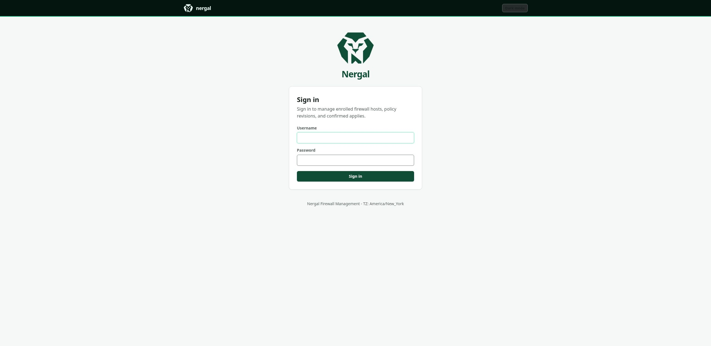
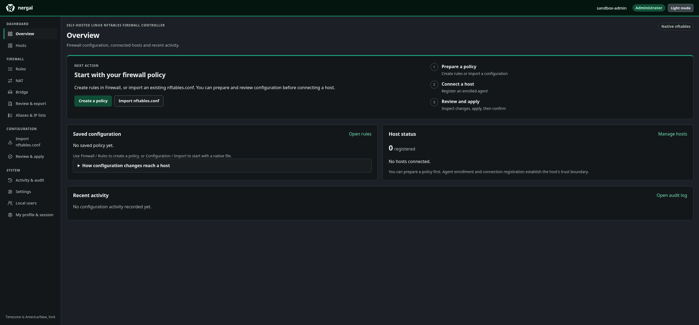
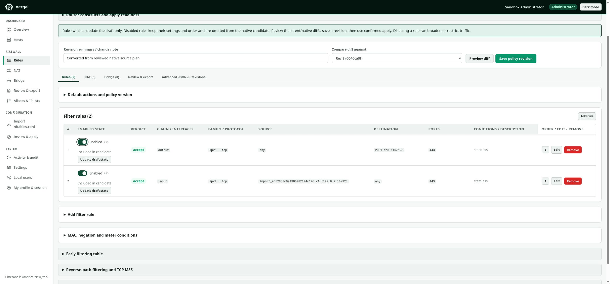
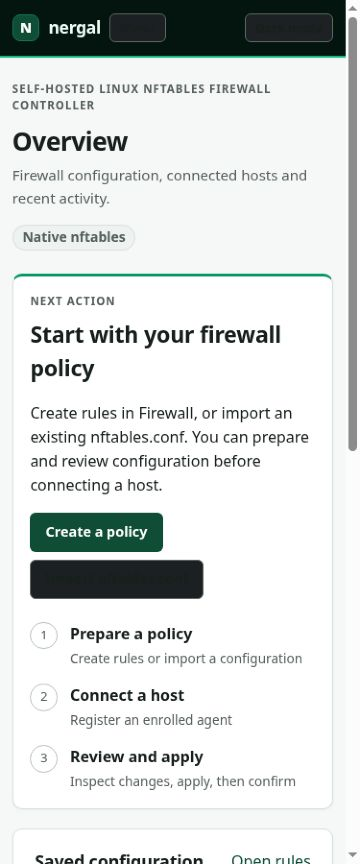
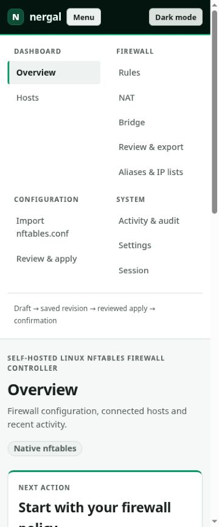

# Appliance-style administration console

Nergal now uses a persistent firewall-appliance sidebar with focused sections,
ordered rule tables and contextual editors. This follows the interaction direction
of OPNsense and pfSense while retaining Nergal's Lantea light/dark styling and native
nftables policy semantics. No PF rule-order, alias-refresh or interface assumptions
are imported. This is the first M5 usability slice; M5 remains in progress.

Open the console root to sign in. Successful authentication opens **Overview**;
returning to the root or sign-in while authenticated also opens Overview.
**Sign out** returns to sign-in and revokes the current local account sessions
(or the current federated ticket). Credential and sign-out forms retain CSRF
protection and fixed local redirects.

[Dark sign-in](../pages/assets/screenshots/console-sign-in-dark.jpg) and
[mobile sign-in](../pages/assets/screenshots/console-sign-in-mobile.jpg) show the same layout in the other supported presentations.

The selected **Guardian** mark appears in the application and documentation
headers, and is centered above the sign-in form with the Nergal wordmark. The
same transparent silhouette uses theme colors for light/dark contrast. A local
Guardian SVG favicon follows the browser theme, with the transparent PNG as a
fallback, in MVC, Blazor and Pages. The
centered sign-in footer shows `Nergal Firewall Management - TZ: <timezone>` using
the browser timezone. Branding assets are local; no external image host is used.

## Find a task

| Sidebar | Purpose |
| --- | --- |
| Dashboard / Overview | Current saved configuration, host checks, five recent events and one next action based on actual state. |
| Dashboard / Hosts | Register an already enrolled agent, inspect connection/peer details, or remove its controller registration. |
| Firewall / Rules | Inspect ordered rules, inline enable/disable, edit/reorder/remove and Add rule. Default actions, MAC/negation/meters, early filtering, raw/MSS and pinned aliases are expandable sections. |
| Firewall / NAT | Guided destination translation and outbound SNAT/masquerade/return rules. |
| Firewall / Bridge | Layer-2/3/4 forwarding and supported jump/return subchains. |
| Firewall / Review & export | Structured intent, native/intent differences and exact saved-revision downloads. |
| Firewall / Aliases & IP lists | The reusable typed list library. References pin a version; editing the library cannot silently change a saved policy. |
| Configuration / Import nftables.conf | Combined source viewer, include/table mapping, conversion plans and separately reviewed revision creation. Administrator only. |
| Configuration / Review & apply | Select a host and revision, inspect status, apply, confirm or roll back using the existing protected agent workflow. |
| System | Attributed activity/audit, settings and the current session. Local users/profiles remain upcoming M5 work. |

The sidebar shows implemented functions only. It does not imply management of
interfaces, DNS, VPNs or other appliance services outside Nergal's declared scope.

## Overview and state

A new installation offers **Create a policy** or **Import nftables.conf** without
requiring a host first. After a revision is saved, the overview guides an
Administrator to host connection registration. Pending confirmation and observed
recovery states take priority over setup. Auditors get inspection guidance and
read-only pages; private source controls remain unavailable.

Saved, applied and observed state stay distinct. A matching agent baseline is not
proof that the latest controller revision is applied. Unavailable means a query
failed; it does not establish that the host itself is offline. Unqueried means no
live check was made. The overview does not turn configuration counts into traffic
charts or claim that registration applied a firewall policy.

Host enrollment, peer identity and credentials remain a local operator trust
boundary. The Hosts form records an explicit connection; it cannot bootstrap
privileged host access or bypass confirmation/rollback.

## Rules and navigation

Rules remain ordered and retain their original positions and pinned restrictions.
Use **Add rule** to open the guided form, and each row's actions for changes.
Advanced conditions remain available in disclosures rather than surrounding every
ordinary task. JSON editing remains an actual locally bundled CodeMirror editor.

Sidebar Rules/NAT/Bridge/Review navigation switches the existing section locally
when the editor is open. This preserves the current draft JSON, unfinished rule
fields and change note. Without JavaScript the links open their explicitly selected
server section; ordinary forms and disclosures still work. Navigating to a different
page or reloading does not save an unsaved draft. Save a reviewed revision to retain
it in database history.

Use Tab to reach navigation and controls. Policy sections support Left/Right arrows
and Home/End, with linked tab/panel accessibility state. **Skip to content** bypasses
the sidebar. On smaller screens **Menu** reveals navigation; Escape closes it and
returns focus to Menu. Light/dark preferences and local-time display remain shared
with the application design system; timestamps stay stored in UTC.

## Verification and remaining M5 scope

Pure guidance tests cover priority, role restrictions and missing/unknown state.
Real HTTPS checks cover section allowlists, anonymous/Auditor denial, dedicated
host registration/removal, CSRF and unchanged state after read/denial. Browser QA
uses empty and populated synthetic databases for draft preservation, code-editor
rendering, keyboard navigation and mobile layout. These presentation changes add
no compiler or packet semantics; existing packet evidence remains applicable.

M5 still needs further authoring simplification and product-wide usability review,
local Administrator/Auditor management and profiles with last-administrator
protection, audit/session revocation, and charts backed by actual observations.
See [milestones](milestones.md).

These screenshots show the current console with synthetic data. Screenshots in
older feature guides retain the navigation from the milestone when they were
captured; use the task map above for their current location.

