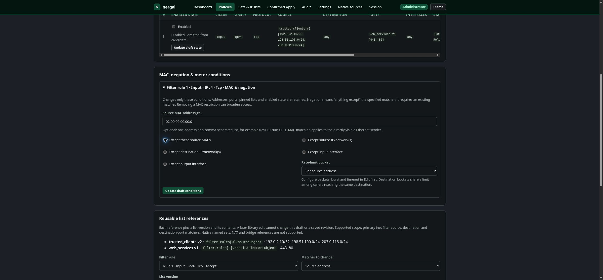
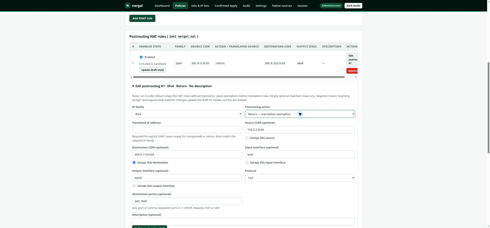
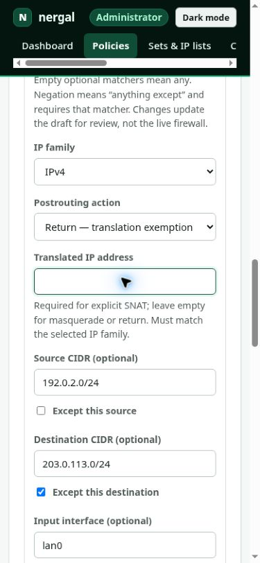

# Guided router conditions and postrouting

In **Policies → Filter**, add or edit a normal rule, then expand its panel under
**MAC, negation & meter conditions**. This separate form preserves the rule's
addresses, ports, pinned list versions, description, position and enabled state.

- Enter one source MAC or a comma-separated list (up to 64 distinct addresses).
  Empty removes the MAC restriction. MACs identify the Ethernet sender visible to
  the firewall; they do not identify a remote sender across routed networks.
- Select **Except** to negate the corresponding matcher. An IP/interface/MAC
  matcher must exist before it can be negated. A pinned address list can be
  negated without replacing its immutable reference.
- Configure packets, burst and timeout using the ordinary rule editor first;
  then select a **Per source address** or **Per destination address** bucket.
  Destination buckets share a limit across callers reaching that destination.
- **Reject — ICMP admin prohibited** is an explicit filter verdict. The native
  candidate uses `reject with icmpx type admin-prohibited`; drop remains separate.

In **Policies → NAT**, use **Add postrouting rule** or expand an existing
postrouting editor below the table. These full-width forms expose:

- **SNAT** with an explicit translated IP matching the rule family;
- **Masquerade**, which uses the output-interface address;
- **Return**, which stops this NAT chain without translation;
- optional source/destination CIDRs, input/output interfaces and their negation;
- any/TCP/UDP protocol and optional TCP/UDP destination port or port list.

Leave the translated address empty for masquerade and return. Incompatible fields
are rejected rather than discarded. Empty optional matchers mean any; clearing a
matcher can broaden traffic. Return exemptions normally precede translation rules.
Editing retains the rule's enabled state and position; adding appends an enabled
rule. Removing a rule is a separate operation.

Every successful submission updates only the draft. Review the intent and native
diffs, save an immutable revision, then use confirmed apply for an explicitly
selected host. These HTTP endpoints cannot invoke the privileged agent. They
require Administrator authorization and antiforgery tokens, reject unknown and
duplicate fields and malformed checkbox values, and compile the entire policy,
including dormant rules, before returning an updated draft. Auditors remain
read-only. No previously saved revision changes during editing.

M2 is still in progress: guided raw/MSS, DNAT negation, auxiliary and extended
bridge/sub-chain authoring remain. The advanced JSON editor remains available for
supported constructs without guided forms. This is not general native
`nftables.conf` conversion; semantic import/export remains M4.

## Verified appearance

These screenshots use synthetic addresses and private disposable test state.
They show the UI, not evidence of packet enforcement.

