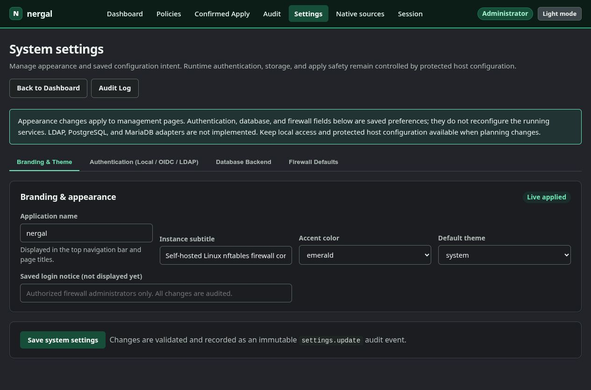
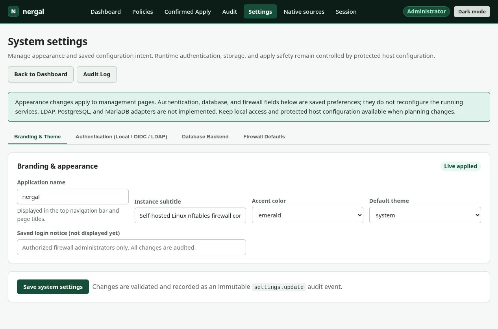

# Local isolated development sandbox

The sandbox runs the real MVC/Blazor controller at
`https://127.0.0.1:5443/manage`. It uses disposable local accounts, protected
persistent session keys, and SQLite controller state. It is not connected to any
production agent. The browser may require the operator to accept/trust the local
self-signed certificate; automation does not bypass that warning.

Use the SDK pinned in `global.json`, Docker Compose, Python 3, OpenSSL, and curl:

```sh
bash tools/dev-stack/up.sh --source /absolute/private/source-directory/nftables.conf
```

Repeat `--source` for additional sources. Public documentation deliberately uses
no production host names, addresses, or exports. On this workstation the initial
private input list is retained under ignored `artifacts/dev-stack/source-map.txt`.
Subsequent refreshes reuse those paths. No private input enters an image build context.

The generated login is in `artifacts/dev-stack/private/access.txt`. Open that file
locally; do not paste credentials into issues, screenshots, or logs. Private state,
certificates, import snapshots, validation reports, build logs, and source mappings
remain under ignored `artifacts/dev-stack/`. The HTTPS certificate lasts 30 days;
replace it deliberately when it expires. No machine trust store is changed by setup.

## Isolation and native source checks

The unprivileged web container has a read-only root filesystem, all capabilities
dropped, `no-new-privileges`, a bounded temporary filesystem, read-only app/source
mounts, and only loopback port publishing. It has no host networking, production
socket, Docker socket, or firewall execution capability.

Each imported source has a separate check-only worker with its own Docker network
namespace (`network_mode: none`), read-only root and source mounts, no host sockets,
and no published ports. Its only added capabilities are namespace-local `NET_ADMIN`
for native `nft --check` and `DAC_OVERRIDE` to read the operator-owned private input
and write its private status report. It never invokes nft without `--check`.
Native diagnostics are captured and discarded, since they can repeat private
addresses; stdout contains no native source. Status reports bind the outcome to the
input SHA-256 at `artifacts/dev-stack/reports/<source>/status.json`.

These workers validate source snapshots without applying them. The authenticated
**Native sources** view is read-only. Translating the exports into managed policy
bundles remains an explicit migration task; no IP-only approximation of MAC-pinned
rules is permitted. See [router support and limits](router-constructs.md).

## Refresh and supervision

`up.sh` restores in locked mode, builds Release, publishes, refreshes the private
source copies, and recreates the stack while preserving accounts, keys, and saved
controller data. It verifies HTTPS health using the exact generated certificate.
Containers restart under Docker's `unless-stopped` policy.

For active development, run this in a retained terminal with the pinned SDK and
writable NuGet cache configured:

```sh
python3 tools/dev-stack/watch.py
```

The supervisor watches application/build inputs and the authorized private source
paths. It debounces edits, runs `up.sh`, and records its last outcome in
`artifacts/dev-stack/watch-status.txt`; build details are in `watch-build.log`.
The last running stack remains available while compilation runs. A refresh error
is reported in that status file; it is not presented as an updated successful build.
The supervisor is a local process, not a boot service or a scheduled automation.

Inspect or stop only this stack:

```sh
export NERGAL_DEV_UID=$(id -u) NERGAL_DEV_GID=$(id -g)
docker compose -p nergal-dev -f tools/dev-stack/compose.yaml \
  -f artifacts/dev-stack/sources.compose.yaml ps
docker compose -p nergal-dev -f tools/dev-stack/compose.yaml \
  -f artifacts/dev-stack/sources.compose.yaml down
```

Stop the supervisor before an intentional shutdown so the next source edit does
not restart the stack. `down` preserves the private files; remove disposable state
only as a separate deliberate action.

## UI reference screenshots

These captures use the synthetic/default local controller, with no imported source
contents or credentials visible. The Pages gallery also includes policy and mobile views.




