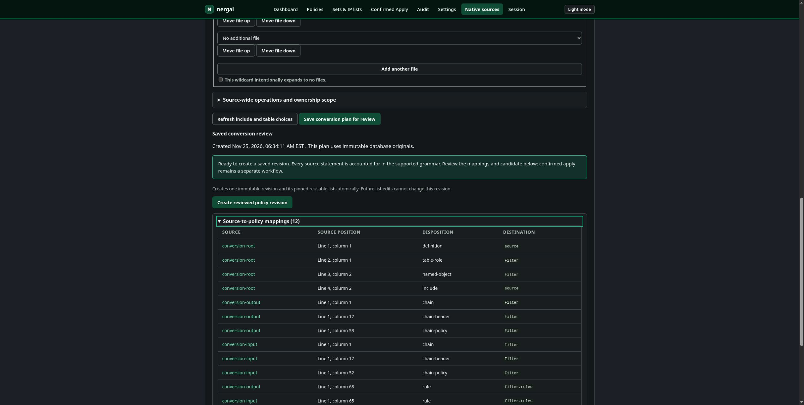
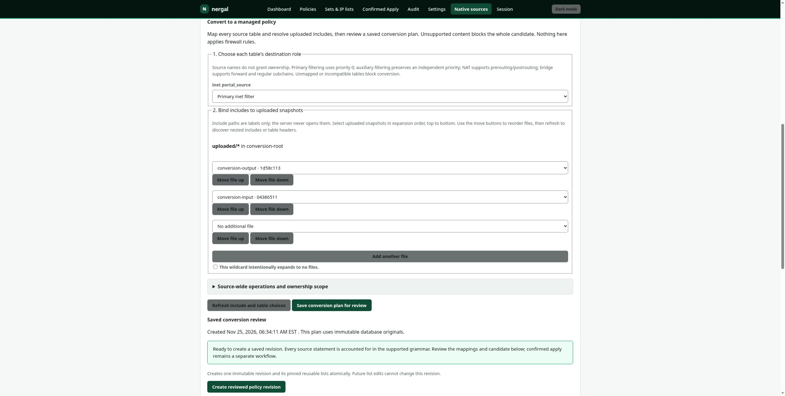
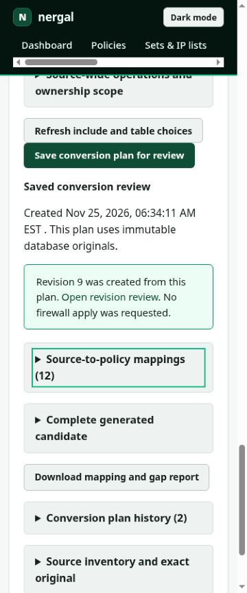
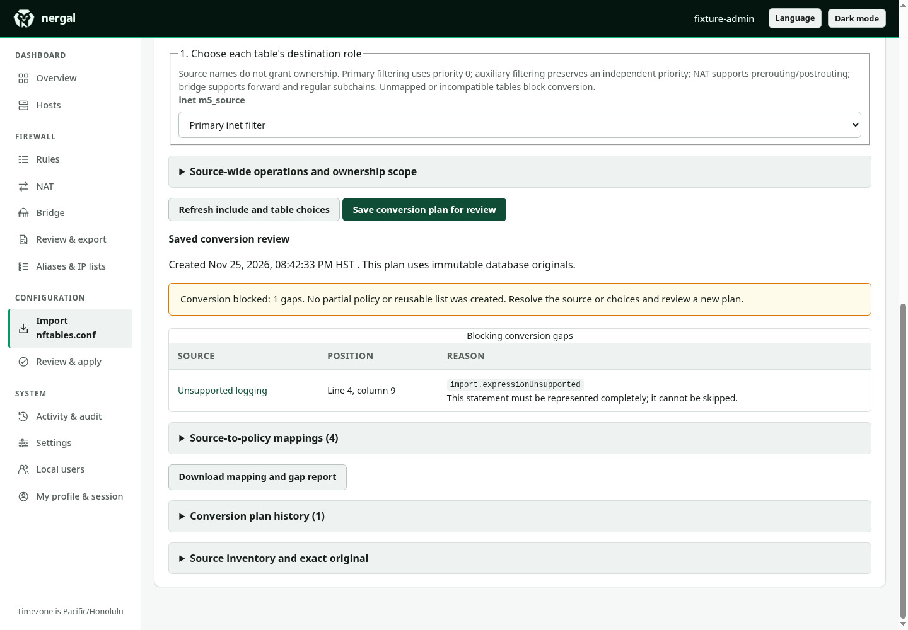

# Native source library and conversion

Administrators use **Native sources** to upload `nftables.conf`, inspect exact
originals and convert the supported native grammar into a reviewed policy. The
viewer and planner share the same bounded lossless token document, delimiter tree
and contextual statement partition. No source command is executed, no server
include path is opened, and no import action contacts an agent.

## Guided workflow

1. Upload each required UTF-8 source with a display name. Each upload receives an
   independent immutable identity, exact byte length, SHA-256, actor and UTC time.
   **Download original** preserves the exact bytes, including BOM and line endings.
2. Select a source and choose each table's destination role: primary inet filter,
   inet NAT, independent auxiliary inet filter or bridge filter. Source names never
   confer ownership. Conversion targets new managed resources, without adopting
   source table identities or altering foreign tables.
3. Bind each include literal to uploaded snapshots in expansion order. The same
   relative literal in different including files has separate bindings. Move files
   up/down, then **Refresh include and table choices** to discover nested includes
   and tables. An explicitly empty expansion is allowed only for a wildcard label.
   Includes never search a filesystem, expand a server glob or skip missing files.
4. Choose **Save conversion plan for review**. This stores immutable source/digest
   dependencies, choices, statement mappings and blocking gaps. Any unsupported or
   unaccounted statement blocks the complete candidate. A successful prefix cannot
   produce a weaker partial policy. Review alone creates no policy or reusable list.
5. For a ready plan, inspect its mappings and complete generated candidate, then
   choose **Create reviewed policy revision**. The server recomputes the plan from
   database originals and atomically saves one linked revision, pinned reusable
   lists and audit entries. Changed, blocked or replayed plans are denied. List edits
   cannot change that revision. No apply is requested.
6. Open the saved revision to review intent, native differences and compatibility.
   Download [native and complete intent exports](policy-exports.md) there. Native
   exports contain the selected managed scope; complete intent also preserves
   disabled rules and pinned snapshots. Host ownership and runtime state are not
   exported. Applying and confirming remain separate authorized workflows.

A source-wide `flush ruleset` before table definitions, or a leading
`destroy table FAMILY NAME` for an explicitly selected table recreated in the
source, requires a recorded choice to restrict cleanup to managed resources.
The planner accounts for those statements in the report and generates create-only
intent. An unselected destroy target, a destroy after its table definition, a
later global flush, and other deletion and live commands remain blocking gaps.

## Declared conversion grammar

This is a bounded v1 grammar, not support for arbitrary nftables language.

| Area | Supported contract |
| --- | --- |
| Tables and chains | Explicit unique role mapping for `inet` filter/NAT/auxiliary and `bridge` filter, supported base hooks, priorities/defaults, ordered rules and bridge regular subchains. Primary filtering uses priority 0, raw prerouting uses -300, DNAT prerouting and output use -100, and NAT postrouting uses 100. |
| Matching and actions | Numeric IPv4/IPv6 prefixes/hosts and anonymous sets, exact interface names, MAC+IP restrictions, supported equality/negation, numeric TCP/UDP ports, supported conntrack states including `untracked`, supported conntrack status, ICMP/ICMPv6, accept/drop/explicit ICMPx reject, and bridge jump/return. Unsupported scope combinations fail full policy validation. |
| Router constructs | Raw prerouting reverse-path FIB drop and UDP source ports, forward SYN MSS clamp, source/destination keyed bounded meters, dual-stack DNAT/SNAT, masquerade and ordered postrouting return exemptions, early auxiliary filtering, and bridge L2/L3/L4 matching. |
| Named sets | Nonempty static IPv4/IPv6/port sets in supported reference slots become immutable version-1 pinned library objects with shared native definitions. Unused declarations and unsupported flags/options remain blocking. |
| Definitions/includes | Ordered lexical `define`/`redefine`/`undefine`, with values captured at definition time; exact uploaded include bindings, cycle/depth and expansion bounds. No host/service name resolution. |
| Native commands | Supported create/add table definitions and add chain/set/rule statements can describe the complete candidate. They are parsed as data and never executed. |

An unconditional forward-chain `tcp flags syn tcp option maxseg size set rt mtu`
becomes an ordered, nonterminal rule. The kernel derives its MSS from routing
state for each matching packet, and the rule retains its position relative to
accepts and drops. The fixed MSS setting remains separately configurable.

Static NAT maps support destination-port to address lookups for DNAT and
source-address to address lookups for SNAT. Conversion emits a typed translation
for each eligible key and preserves fallthrough when the key is absent.
Destination NAT jumps can call bounded acyclic regular chains whose eligible
rules only translate, jump, or end with an unconditional return. Conversion
intersects each reachable rule with the jump's matches and preserves its order.
Counters, negation, and conditional returns in a projected call deny conversion.

Raw prerouting and raw output use priority −300 and retain ordered standalone
`notrack` statements with supported predicates. The planner requires an
accept-default raw chain. It rejects a `notrack` statement on an ordinary
filter hook, where it would run after connection tracking.

Positive sets of exact interface names and supported ICMP types can expand into
disjoint ordered rules. The explicit `meta l4proto { tcp, udp }` guard supports
shared `th sport` and `th dport` selectors where the destination policy accepts
the respective port. Rules that would split a counter, meter or jump are rejected.
Filter rules support a plain inline `counter` at the end of a rule or
immediately before a final verdict. A counter-only rule evaluates the next rule
after counting. A family-neutral rule with family-independent predicates
compiles as one inet rule, so both IPv4 and IPv6 contribute to the same counter.
Family-scoped NAT rules can count packets immediately before their action.
Filter and postrouting rules can match DNAT connection status and literal
original source or destination addresses. The original-address selectors require DNAT status
and remain distinct from ordinary selectors on the translated packet.
Counters start at zero when the rule is installed. Output DNAT retains its own
hook and order and requires an original destination restriction. Bare inet
`reject` maps to ICMPx port unreachable, and explicit ICMPx admin prohibited
retains its distinct response.
Named `iif` selectors resolve to an interface index when nftables installs the
rule. The managed receipt distinguishes this binding from `iifname`, which
matches the current name. A rename can change the name reported by the kernel
and therefore invalidate the receipt, even when the bound index is unchanged.

In inet filter and NAT rules, interface-name matches support validated exact
names and nonempty prefixes with a terminal `*`. A supported interface-name
set and a guarded TCP/UDP destination-port set can remain on one filter rule
with a single shared counter. Regular filter calls retain their table-local
chains and both explicit and implicit returns.

Inline address sets remove redundant CIDRs and merge aligned siblings when
the resulting network covers exactly the same addresses. When adjacent
nonmergeable CIDRs appear as one interval in a kernel receipt, the observer
reconstructs their exact prefix cover within the same entry limit.
Nested literal sets introduced by native definitions are flattened into a
single bounded selector. Native CIDRs are masked to their network address as
nftables does. Managed policy inputs continue to require canonical CIDRs.

Named counters, seeded counters, logging, other maps, concatenations, arbitrary/dynamic objects, unsupported
control flow, unknown flags, other wildcard or escaped matchers, service names, unsupported
repeated restrictions and trailing input are explicit gaps. The narrowly supported
dynamic set form is a private implementation of one bounded meter, with exact
flags/size, key, per-entry timeout, rate and burst. Whole-second and whole-minute
timeouts map to bounded seconds in managed policy. An omitted packet burst uses
the native default of five packets. Shared arbitrary dynamic sets
are unsupported. Full private migration acceptance remains M8.

Native inline `meter` and explicit `update @set` refresh an entry's expiry on
matching attempts; explicit `add @set` retains creation-based expiry. Conversion
preserves this difference. Existing intent defaults to creation expiry; new refresh
intent carries an explicit capability and JSON field. Guided meter controls expose
and preserve the choice. Controller and agent must both understand refresh intent;
older strict codecs reject it. Operation-only native drift is detected.

## Diagnostics, originals and bounds

Optional **Source inventory and exact original** details retain the original and
legacy masked inventory. Its schema-3 structure/basic-expression report is an
inspection aid, not the conversion readiness gate. The saved conversion plan uses
a separate schema-1 mapping/gap envelope with source IDs, digests, positions and
stable codes. It excludes source values and executable candidate text. Plan history
and downloads retain every gap; the page bounds the displayed rows.

Coordinates use UTF-16 offsets and physical line/column positions; tabs count as
one column. CRLF, CR, LF, BOM, comments and continuations remain exact in originals.
Malformed lexical/structural input produces no partial tree or candidate. The
original remains available even when conversion is blocked.

Bounds are 512 KiB strict UTF-8 per source, 65,536 significant and 131,072 total
tokens per document, 64 delimiter groups deep; conversion permits 32 distinct
snapshots, 2 MiB combined source bytes, 8 include levels and 131,072 expanded terms.
Literal collections are bounded to 64 entries. Exhausted bounds fail explicitly.

## Storage and authorization

Originals, plans, mappings/gaps, immutable revisions, reusable lists and attributed
audit live in the controller database. Files are derived artifacts. Source and plan
history have checked no-update/no-delete SQLite protections. Anonymous and Auditor
requests cannot inspect private sources, download reports or perform conversion.
Administrator actions require CSRF; malformed, duplicate and unknown form input
is denied. Review/commit failures leave no partial object/revision/audit writes.

The source library permits 128 records and 32 MiB retained bytes. Conversion history
permits 128 plans and 64 MiB total content, with bounded request/report/intent fields.
No deletion/retention UI is implemented. UTC instants display in the browser's local
timezone with an explicit indication and the stored UTC instant in the tooltip.

Current controller stores use **schema 6**. Initialize a fresh controller store
with `nergal-admin controller init ABSOLUTE_CONTROLLER_DIRECTORY`. Startup
rejects retired or unknown schemas. Initialization refuses to replace an
existing database or its SQLite sidecars. Controller, identity and protected
agent stores are independent. Other SQL backends remain M6 work.

`NativeSources:Directory` is optional staging: **Import staged …** makes a new
immutable database copy; later file changes cannot overwrite it. A basic
installation requires no staging directory or particular topology.

## Verification and appearance

Unit/real-SQLite/HTTPS checks cover complete consumption, definitions/includes,
immutable plans, denied roles/CSRF/malformed inputs, restart, concurrent replay and
transaction rollback. Independent native inputs and imported candidates receive
real dual-stack routed/raw/MAC/MSS/meter/NAT checks in disposable namespaces.
Continued-traffic checks distinguish creation and refresh expiry. Imported intent
also passes complete native receipt, bridge, confirm and independent watchdog
rollback scenarios. These synthetic checks do not establish arbitrary production
conversion equivalence. See [testing](testing.md).

These authentic captures use an isolated controller with synthetic uploaded files.
They show a complete plan in dark/light mode, the separately committed revision on
a 375-pixel mobile viewport, and an unsupported counter producing a blocking gap.
No private source or topology appears.

