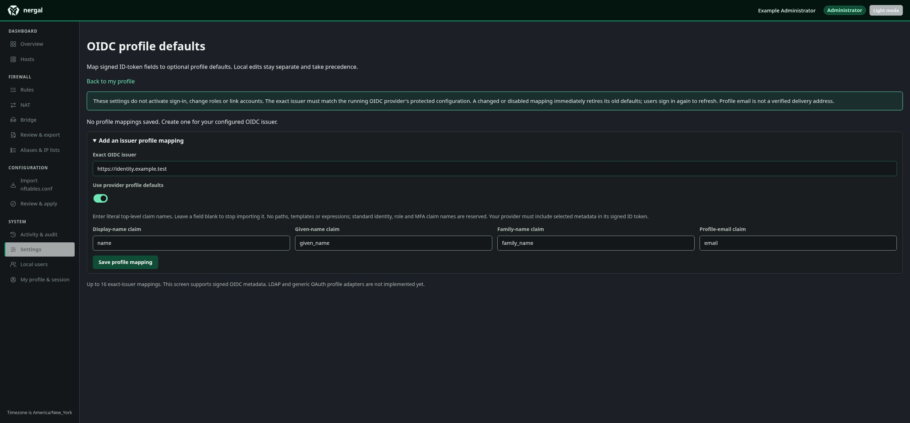

# OIDC profile defaults

Administrators open **Settings / Authentication / Manage OIDC profile defaults**
or the configuration link on **My profile**. Add an exact HTTPS issuer and choose
literal top-level signed ID-token claim names for display name, given name, family
name and profile email. Standard selectors are `name`, `given_name`, `family_name`
and `email`; providers can use different literal names. Blank selectors turn off
individual fields. Up to 16 exact-issuer mappings are supported.

These controls map descriptive metadata. They do not activate sign-in or change
the protected issuer, client, callback, group or role configuration. LDAP and
generic OAuth profile adapters and local MFA remain
M5 work. Providers must include selected claims in the signed ID token. Nergal
requests `openid profile email`; it does not call UserInfo or fetch remote images.

## Save and refresh

The enabled switch uses the shared green/red accessible control. Saving changes
increments the mapping version and commits an attributed identity audit event.
Unknown/repeated fields, invalid selectors, non-HTTPS issuers, stale versions,
missing CSRF and non-Administrator callers are denied. Standard identity, role and MFA
claim selectors are reserved. There are no expressions or nested lookup paths.
Disabling retains the selectors and history.

A changed or disabled mapping immediately makes prior provider defaults ineligible.
An eligible user signs out and signs in again to refresh from a fully validated authorization-code
exchange. Signature verification alone cannot write metadata: nonce, state,
correlation, issuer, audience and protocol validation must also complete. Storage
failure cannot produce a fresh registered session. Local password sign-in remains
independent of provider availability.

Missing or invalid optional values become empty fields with explicit value-free
missing/invalid diagnostics on the user's profile. Arrays, objects, controls,
malformed Unicode and oversized values are never concatenated or inferred.
Ambiguous duplicate claims are rejected. No raw token or provider payload is saved
in a cookie, log or audit record.

## Personal overrides and provenance

**My profile** shows the verified sign-in identity and application role separately
from personal metadata. Names allow 80 Unicode scalar values each; profile email
accepts a bounded mailbox address. Nonempty local fields override provider defaults
independently. Leaving a field blank uses current provider metadata; the display
name ultimately falls back to the verified sign-in name.

Fresh provider observations never overwrite local edits or increment their version.
The provider card shows exact issuer, mapping version, observation time and any
missing/invalid field diagnostics. Reads do not create rows or audit events.
Equal names or email values never link accounts or merge distinct issuer/subject
identities. A profile email is descriptive and unverified for delivery: it does
not enroll email MFA, enable recovery or establish ownership, even when the provider
also supplies `email_verified`.

## Persistence and verification

Account schema 4 stores current typed mappings, exact-actor provider observations,
personal overrides and append-only identity audit in the protected identity store.
Mapping and observation mutations commit their audit atomically. UTC instants are
displayed in the browser's local timezone. Ordinary application startup refuses
previous or incomplete schemas; unreleased development data is preserved through
separate offline maintenance rather than a shipped compatibility layer.

Core tests cover bounded literal projection, malformed metadata, optional diagnostics
and defensive snapshots. Real SQLite tests cover actor isolation, role/stamp/version
checks, mapping retirement, preserved overrides, audit rollback and schema corruption.
HTTPS fixtures exercise mapping forms and profile edits with CSRF/RBAC denials.
The disposable real OIDC issuer verifies mapped signed claims, nonce-failure
non-persistence, refresh without lost overrides, escaped output and audit-failure
sign-in denial. These checks add no packet/compiler/agent semantics.

See [ADR 0059](decisions/0059-oidc-profile-defaults-and-local-overrides.md),
[local users and profiles](local-users-and-profiles.md) and [federated login](federated-login.md).

## Screenshots

These screenshots show a synthetic unsaved mapping form; they contain no real
provider credentials, account data or private topology.

[Light form](../pages/assets/screenshots/oidc-profile-mapping-light.jpg) and
[mobile form](../pages/assets/screenshots/oidc-profile-mapping-mobile.jpg) share the same
controls. [Personal overrides](../pages/assets/screenshots/m5-profile-light.jpg) are
separate from provider defaults.

Configure live provider trust and credentials on the separate [OIDC connection](oidc-connection.md) screen.
