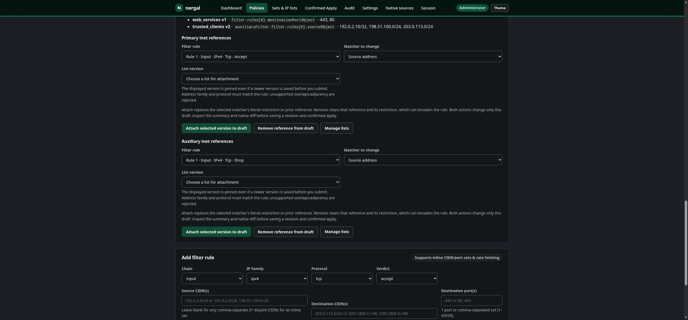
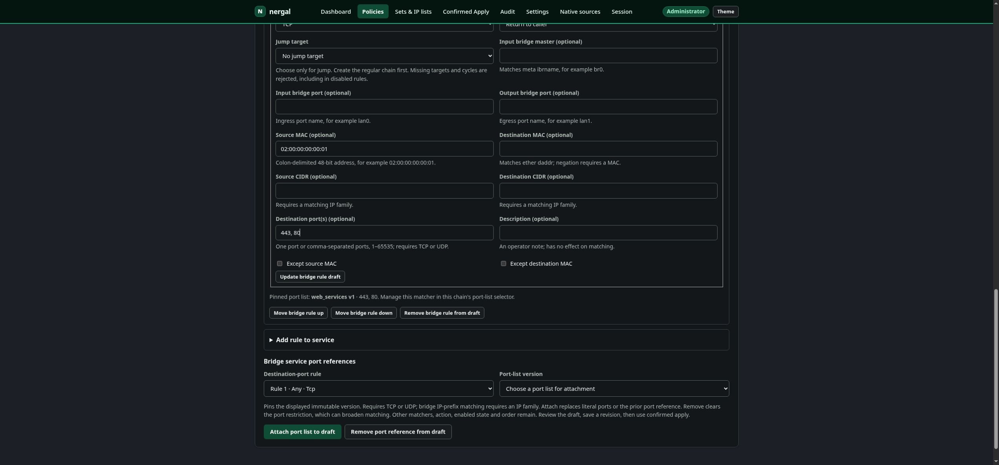
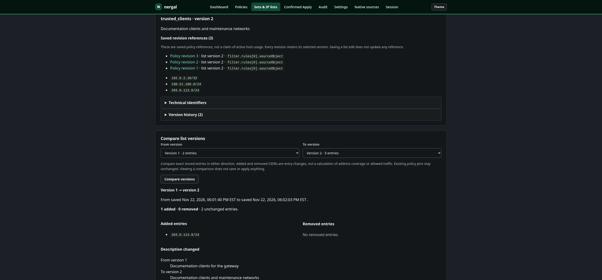
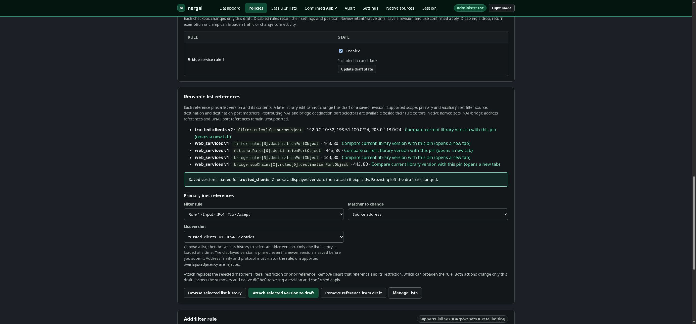

# Typed sets and IP lists library

Open **Sets & IP lists** (`/manage/objects`) to create and maintain typed lists.
Library management and pinned primary/auxiliary inet filter-rule references are implemented;
native named-set compilation is not implemented. Saving a list changes database history only.
It does not create a policy revision, apply a firewall or change saved policies.

## Everyday workflow

1. Choose **New list**. Enter a unique lowercase name such as `trusted_clients`
   and select IPv4, IPv6 or transport ports. Names/types remain fixed after creation.
2. Add an optional description and 1–64 entries, one per line. Forms include
   accessible contextual hints; JSON or native syntax is not required.
3. Save the list. Numeric addresses become canonical `/32` or `/128` prefixes;
   CIDRs must have zero host bits. IPv6 spelling and port numbers are normalized.
   Entries are sorted, with overlapping prefixes retained without merging.
4. Search by name/description and select a list to view or edit. Every save appends
   an immutable version and attributed audit event in the same transaction.
5. Expand **Version history** to inspect an older snapshot. Historical views are
   read-only. They do not restore contents or change the latest version.

IPv4/IPv6 lists cannot mix address families. Hostnames, scoped/mapped addresses,
address/port ranges, duplicate canonical entries, dynamic flags and timeouts are
rejected. Transport ports are individual integers from 1 to 65535; TCP versus UDP
belongs to the referencing policy rule, not the list. Descriptions are plain text
up to 500 characters. Blank lines and surrounding entry whitespace in forms are
ignored; unsupported tokens are never passed through to nftables.

Administrators can create/edit; Auditors can inspect/search/history only. Anonymous
requests are denied. All writes require CSRF protection. Invalid values are retained
with actionable guidance. A stale edit returns HTTP 409 with the user's input,
without overwriting the newer version. Compare with the current version before
editing again. There is no force-save action. Names/types are immutable and no
object deletion/rename workflow is provided in this first slice.

## Persistence and support boundary

The controller database is canonical. Object identity, type, contents, digest,
version, actor and UTC time persist across restarts. Browser times are local with
an explicit timezone indication. Immutable SQL protections cover identities and
history, and selected contents are verified against canonical serialization and
SHA-256. Lists are limited to 128 objects and 64 immutable versions per object.
Capacity failures leave no partial object or audit event.

New stores use controller schema 3. Existing schema-1/2 controllers must stop their
writer, take a verified SQLite backup, then run the explicit offline
`nergal-admin controller upgrade ABSOLUTE_CONTROLLER_DIRECTORY` before restarting.
The upgrade preserves source snapshots, policy revisions, hosts, settings and audit;
unknown versions, colliding tables and forged protections are rejected. The web
process does not migrate. See [source-library upgrade procedure](native-source-library.md#existing-controller-databases).
Additional SQL backends and their migrations remain deferred.

Pinned references retain identity/version and resolved contents in saved policy
JSON. Library detail shows saved revision references without inferring live host
usage. A list edit never silently changes a saved policy. Native named-set
observation and packet/rollback conformance remain a separate capability.
See [ADR 0039](decisions/0039-versioned-typed-object-library.md).

## Pinned inet filter-rule references

Policies can attach the displayed list version to a primary or auxiliary inet
filter rule's source address, destination address or destination ports. Open
**Policies → Reusable list references**, use the explicitly labeled primary or
auxiliary form, select a rule, matcher and version, then
choose **Attach selected version to draft**. This explicitly replaces that
matcher's literals or previous reference. Check the rule summary and native diff,
save a policy revision, then use the existing confirmed-apply workflow.

Canonical policy JSON retains the object's identity, version, name, type, contents
and content digest. Preview/save verifies the snapshot against immutable database
history. Compiling or applying a saved revision never looks up "latest". An older
pinned version remains valid after a library edit; reselect the newer version
explicitly in a draft to change policy. Normal rule editing and reordering retain
references. Literal fields for pinned matchers are read-only in the rule form.
**Remove reference from draft** clears that matcher and its negation, which may
broaden the rule; inspect the change before saving/applying. It does not retain a
hidden copy of the old values.

The library detail page shows every matching saved valid policy revision and
matcher path, including older list versions. This is reference/impact visibility,
not an assertion of active use on a host. A list edit does not update those
revisions automatically. Reference-only metadata changes are visible in the
reference summary even when native text is unchanged.

This is controller reuse, not native named nftables sets. Compilation projects the
embedded snapshot onto the existing scalar/anonymous-set matcher contract. No
identity/version is discarded from saved intent. Singletons become scalar matches;
multiple addresses must satisfy the existing disjoint/non-adjacent prefix bounds.
Overlapping or adjacent entries may be stored in the library but are rejected when
attached to a rule if native observation cannot round-trip them. Family/protocol
mismatches, conflicting literals, unknown flags and missing/forged references fail
explicitly. Native named sets/maps, dynamic lists, NAT/bridge address references,
DNAT port references and semantic native import remain unsupported. Primary and auxiliary forms select their own rules; auxiliary attachment preserves
the primary policy, table priority, MAC restrictions, negation, rule order and
enabled state. Omitting scope in existing API submissions continues to select
primary filtering; query parameters cannot select an auxiliary target. Unknown,
empty or duplicate submitted scopes are rejected. Use updated controller and agent builds; older codecs reject the new
fields rather than silently accepting weaker policy.

No database schema change is needed beyond schema 3. See
[ADR 0040](decisions/0040-pinned-controller-policy-references.md).

Auxiliary selectors reuse controller schema 3 and the existing embedded snapshot
contract; no SQL migration or compiler semantics change is required. Saved usage
paths include `auxiliaryFilter.filter.rules[n]` and old versions remain immutable.

## Pinned postrouting and bridge port lists

Postrouting NAT and bridge destination-port matchers can pin a **Port** list. In
**Policies → NAT**, use **Reusable postrouting port lists** below the postrouting
editors. In **Policies → Bridge**, use the port-list selector inside the forward
or regular-chain panel. Select a rule and displayed version, then **Attach port
list to draft**. Port lists require TCP or UDP; bridge IP-prefix restrictions
require an IP family, while transport matching can cover both families.

Attachment replaces literal destination ports or a prior port reference. It retains
the action/translation, MAC/IP restrictions, jump/return, priority, enabled state
and order. Ordinary editors show the pinned name/version/entries and make literal
ports read-only. Change the reference explicitly in its selector. **Remove port
reference from draft** clears only that port restriction, which may broaden matching.
Review the intent/native diffs, save an immutable revision, then use confirmed apply.

Canonical intent retains `destinationPortObject` on postrouting or bridge rules,
including regular chains. Singleton snapshots project to scalar port matching;
larger lists project to the existing anonymous port-set matcher. Saved usage paths
include `nat.snatRules[n]`, `bridge.rules[n]` and `bridge.subChains[n].rules[n]`.
Database verification covers every scope, including disabled rules. Later library
edits cannot change saved snapshots. Native observations describe projected kernel
matchers; exact artifacts and complete ownership receipts still gate apply and
rollback. Use updated controller and agent builds; older strict codecs reject the
new fields. No controller database schema upgrade is needed.

This does not implement native named sets or NAT/bridge address lists and does not
expand rules or approximate unsupported translation-list semantics. See
[ADR 0042](decisions/0042-transport-port-list-references.md).

## Compare versions before changing a pin

Open a list and use **Compare list versions**. Choose **From version** and
**To version**, then **Compare versions**. Either direction and same-version
comparisons are supported. The view shows added, removed and unchanged canonical
entries, description changes, each version's local save time and counts of saved
references to the compared versions. Revision links above the comparison identify
the matcher locations. Counts include historical revisions and dormant rules;
they are not active host or traffic measurements.

CIDRs are compared as exact stored entries, without calculating address coverage
or deciding whether access broadens. For example, replacing a `/64` with a `/48`
is one removed entry and one added entry. The surrounding policy matchers,
negation, rule order and verdict determine enforcement.

Each pinned reference in the policy summary includes **Compare current library
version with this pin**, opening a separate tab so an unsaved draft remains open.
Compare the immutable pinned version against the current stored version before
explicitly updating the reference in a draft. This read-only workflow is also
available to Auditors. It creates no list version, policy revision, audit event or
firewall apply; existing pins remain unchanged.

## Select a historical list version in a draft

In any supported reference form, choose a rule, matcher and list, then **Browse
selected list history**. This loads that list's immutable versions into the same
selector while retaining the table/chain, rule index, matcher, selected version,
revision comparison baseline and draft summary. It does not alter any rule or pin.
Only one list history is expanded at a time; other lists retain their current
versions, so the UI does not load every historical list snapshot.

Choose the desired displayed version and **Attach** it explicitly. The controller
validates its exact stored snapshot, matcher type and the complete policy. A newer
library edit cannot substitute its contents for the submitted old version. Ordinary
draft actions may reset selector choices to current versions; existing pins remain
unchanged. Browse history again to select another historical version.

Browsing requires the same Administrator/CSRF-protected draft form as attachment.
Auditors can inspect immutable history and comparisons in the library. Missing
versions, invalid targets, unknown/duplicate fields and invalid drafts are denied.
No version, revision, audit event or firewall operation occurs during browsing.
Older snapshots do not bypass compiler restrictions; inspect the draft and native
diffs, save a revision, then use confirmed apply.

