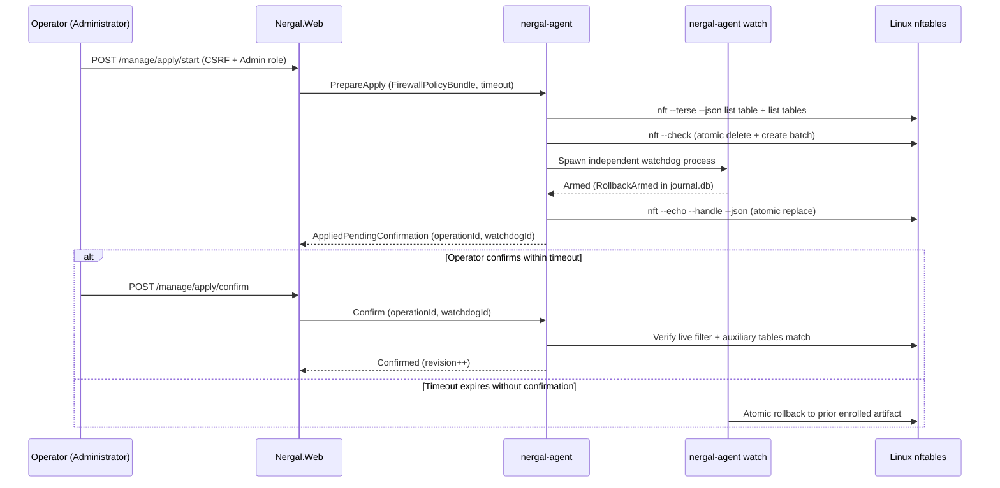

# Architecture & Trust Boundaries

nergal separates policy authoring, compilation, identity/session handling, and kernel firewall enforcement into explicit assemblies and OS processes.

## Solution Layering

- **`Nergal.Core`**: Framework-independent domain POCOs (`FilterPolicy`, `NatPolicy`, `BridgePolicy`, `FirewallPolicyBundle`, `PolicyBundleJsonCodec`, `AgentControlRequest`/`Reply`, `ApplySession`). No ASP.NET, SQLite, or shell dependencies.
- **`Nergal.Nftables`**: Pure compilers (`NftFilterCompiler`, `NftNatCompiler`, `NftBridgeCompiler`, `NftPolicyBundleCompiler`) and strict JSON observation parsers (`NftTableObservation`, `NftReceiptVerifier`).
- **`Nergal.LocalState`**: Owner-only SQLite apply journal (`journal.db`, schema v3) storing enrollment identity, boot/namespace-bound receipts, and operation history.
- **`Nergal.ControllerState`**: Owner-only SQLite controller database (`controller.db`) storing managed hosts, monotonic policy revisions, and an append-only audit log.
- **`Nergal.LocalTransport` / `Nergal.RemoteTransport`**: Bounded length-prefixed framing over Unix domain sockets (`SO_PEERCRED` peer UID verification) and pinned TLS 1.3 mutual TLS (`AllowTlsResume = false`).
- **`Nergal.Agent` (`nergal-agent`)**: Privileged host daemon (`CAP_NET_ADMIN`) owning kernel `nft` execution and autonomous local watchdog rollback.
- **`Nergal.Web`**: Unprivileged ASP.NET Core MVC + Blazor controller (`CapEff == 0`).
- **`Nergal.Admin` (`nergal-admin`)**: Offline CLI for one-time local account DB initialization, password provisioning, and controller DB initialization.

## Two-Phase Confirmed Apply Sequence

## Non-Negotiable Safety Invariants

1. **Foreign table preservation**: nergal never executes `flush ruleset` and never deletes or modifies tables lacking its own `nergal:v1:<owner>:<resource>` ownership comment.
2. **No shell interpolation**: Native `nft` invocations pass fixed argv arrays via `ProcessStartInfo.ArgumentList` and feed compiled artifacts over stdin.
3. **Fail-closed collision handling**: If an unowned `inet nergal_filter`, `inet nergal_nat`, or `bridge nergal_bridge` table exists, enrollment and apply refuse to proceed.

## Unreleased router and settings work

See [Router Migration & Local Sandbox](router-migration-and-sandbox.md) for the
current support matrix, supported apply scope and recovery limits, saved-settings/runtime distinction,
private source inspection, container isolation, verification limits, and screenshots.
This local development work is not a published release.

Reusable port-list versions can also be embedded in postrouting and bridge rules,
including regular chains. Framework-independent projection supplies existing
literal matchers; the database retains immutable identity/version/content and
saved usage paths. Complete native observations and protected receipts still gate
apply/rollback. No agent database lookup or new privileged browser operation is
introduced. See [reusable object contracts](reusable-object-library.md).

Read-only list comparison loads two stored versions of the same identity/type.
It compares canonical entries and descriptions, without network coverage analysis
or live-host inference. Policy pin links open comparison in a separate tab.
Existing database history, desired state, audit and apply receipts are unchanged.

A draft reference form may explicitly load one bounded immutable list history
for selection. Other lists retain their current-version choices. Target/form
selection is presentation state; browsing never changes canonical intent and
compilation/apply still use only the exact embedded, validated version snapshot.

Postrouting address lists project to scalar or bounded anonymous prefix sets,
retaining identity/version/content in immutable intent. Native observations retain
both complete sets; address-set receipts use an explicit v3 fingerprint while old
scalar/port-only fingerprints remain unchanged. Guided/legacy edits preserve pins
and explicit removal cannot erase a required SNAT source. No new host operation
or controller database lookup during apply is introduced. See the reusable library.

Bridge address-list snapshots are embedded in immutable policy intent for both
forwarding and regular chains. Compilation resolves same-family snapshots without
a database lookup and retains every prefix through native reconstruction. Complete
address-set graphs use a v3 fingerprint; preceding scalar/port-only fingerprints
stay unchanged. MAC restrictions, explicit family, bridge master and jump/return
control flow remain conjunctive. Invalid dormant rules are denied too. See
[the list workflow](reusable-object-library.md).
