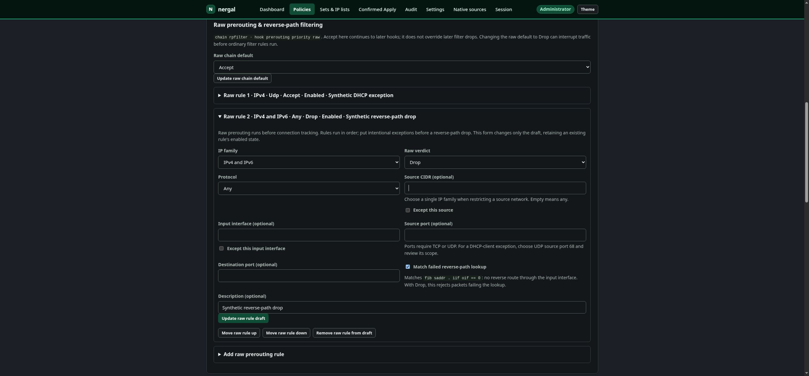

# Guided router conditions and postrouting

In **Policies → Filter**, add or edit a normal rule, then expand its panel under
**MAC, negation & meter conditions**. This separate form preserves the rule's
addresses, ports, pinned list versions, description, position and enabled state.

- Enter one source MAC or a comma-separated list (up to 64 distinct addresses).
  Empty removes the MAC restriction. MACs identify the Ethernet sender visible to
  the firewall; they do not identify a remote sender across routed networks.
- Select **Except** to negate the corresponding matcher. An IP/interface/MAC
  matcher must exist before it can be negated. A pinned address list can be
  negated without replacing its immutable reference.
- Configure packets, burst and timeout using the ordinary rule editor first;
  then select a **Per source address** or **Per destination address** bucket.
  Destination buckets share a limit across callers reaching that destination.
- **Reject — ICMP admin prohibited** is an explicit filter verdict. The native
  candidate uses `reject with icmpx type admin-prohibited`; drop remains separate.

In **Policies → NAT**, use **Add postrouting rule** or expand an existing
postrouting editor below the table. These full-width forms expose:

- **SNAT** with an explicit translated IP matching the rule family;
- **Masquerade**, which uses the output-interface address;
- **Return**, which stops this NAT chain without translation;
- optional source/destination CIDRs, input/output interfaces and their negation;
- any/TCP/UDP protocol and optional TCP/UDP destination port or port list.

Leave the translated address empty for masquerade and return. Incompatible fields
are rejected rather than discarded. Empty optional matchers mean any; clearing a
matcher can broaden traffic. Return exemptions normally precede translation rules.
Editing retains the rule's enabled state and position; adding appends an enabled
rule. Removing a rule is a separate operation.

Every successful submission updates only the draft. Review the intent and native
diffs, save an immutable revision, then use confirmed apply for an explicitly
selected host. These HTTP endpoints cannot invoke the privileged agent. They
require Administrator authorization and antiforgery tokens, reject unknown and
duplicate fields and malformed checkbox values, and compile the entire policy,
including dormant rules, before returning an updated draft. Auditors remain
read-only. No previously saved revision changes during editing.

## Raw prerouting and MSS

In **Policies → Filter**, **Raw prerouting & reverse-path filtering** creates the
optional `rpfilter` chain with `hook prerouting priority raw`. Its default is
explicitly selectable as accept or drop. Accept in this early hook continues to
later hooks; it does not override ordinary filter drops. A drop default can
interrupt traffic before ordinary filter rules run.

Expand **Add raw prerouting rule** to choose either/both IP families, protocol,
source CIDR and ingress restriction/negation, source/destination ports, verdict,
and the failed reverse-path lookup matcher (`fib saddr . iif oif == 0`). A source
CIDR requires a single matching IP family; ports require TCP or UDP. An intentional
DHCP exception can use UDP source port 68. Scope exceptions carefully and move
them ahead of a FIB drop using the raw rule's up/down controls. Raw edits and moves
preserve enabled state. Remove rules individually before removing an empty raw
chain; removing a drop-default chain can broaden access.

**Forward TCP MSS clamping** configures an explicit size in the supported
536–1460-byte range, for forwarded SYN packets in both IP families. It does not
accept traffic. Resizing preserves a configured clamp's enabled flag. Use the
separate Enabled control to disable while retaining the size, or **Remove MSS
configuration from draft** to remove it explicitly. Adding a new clamp enables it.

## DNAT conditions and NAT order

In **Policies → NAT**, **DNAT negation conditions** changes source, original
destination and input-interface negation without replacing translation settings,
ports, order or enabled state. Source and interface negation require an existing
matcher. Existing basic edits preserve these flags and still reject removal of a
matcher while its negation remains set.

DNAT and postrouting table up/down buttons move a whole rule by one position,
including its disabled flag and every matcher. Place return exemptions before
translation rules as required by the intended policy. Reordering remains a draft
change and must pass the same revision review and confirmed-apply workflow.

M2 is still in progress: guided auxiliary and extended bridge/sub-chain authoring remain. The advanced JSON editor remains available for
supported constructs without guided forms. This is not general native
`nftables.conf` conversion; semantic import/export remains M4.

## Verified appearance

These screenshots use synthetic addresses and private disposable test state.
They show the UI, not evidence of packet enforcement.

