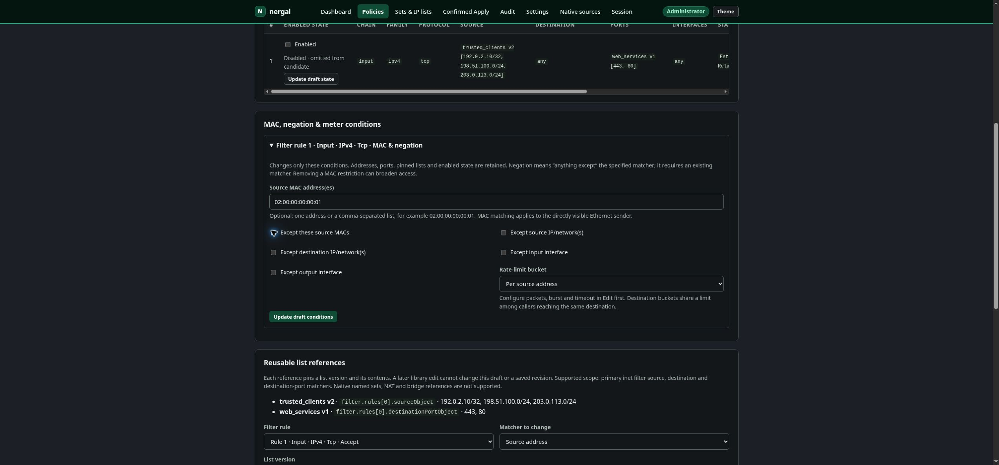
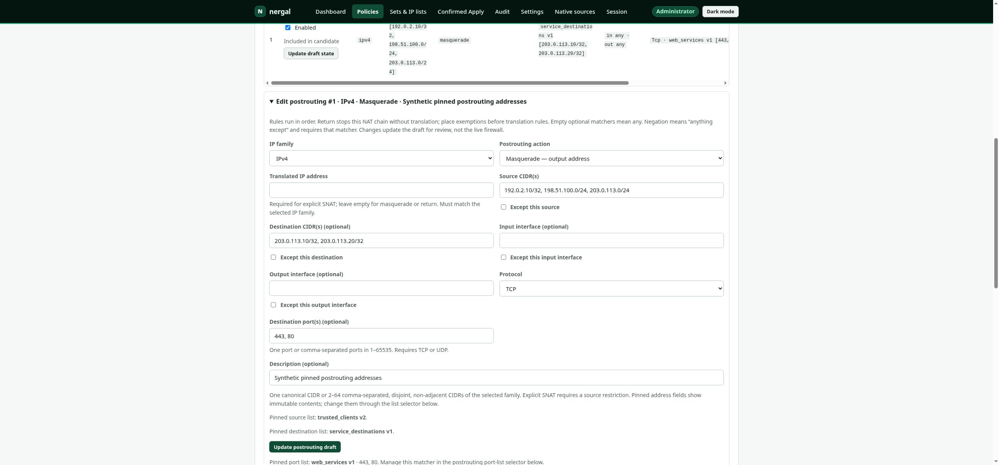
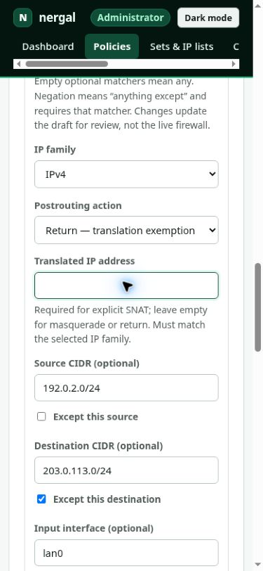
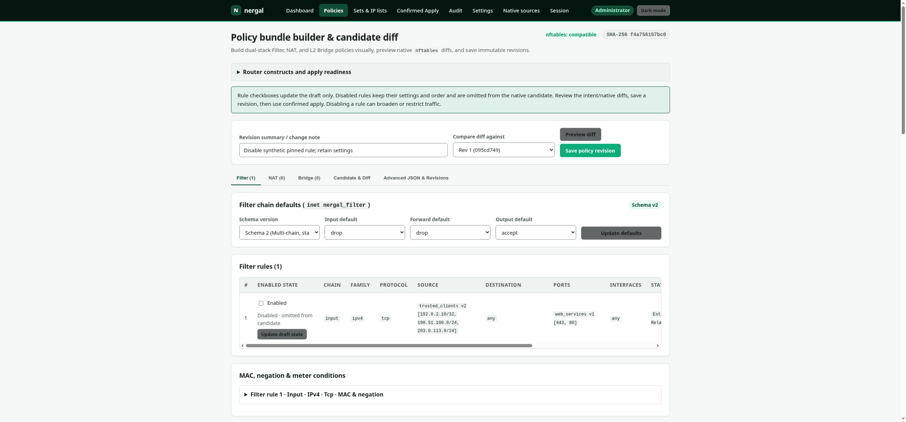
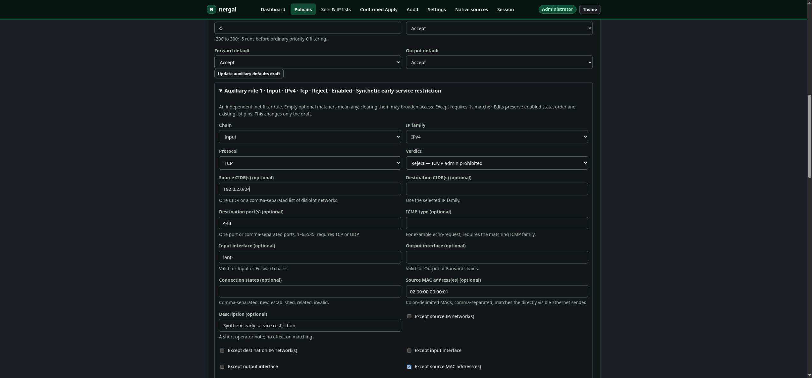
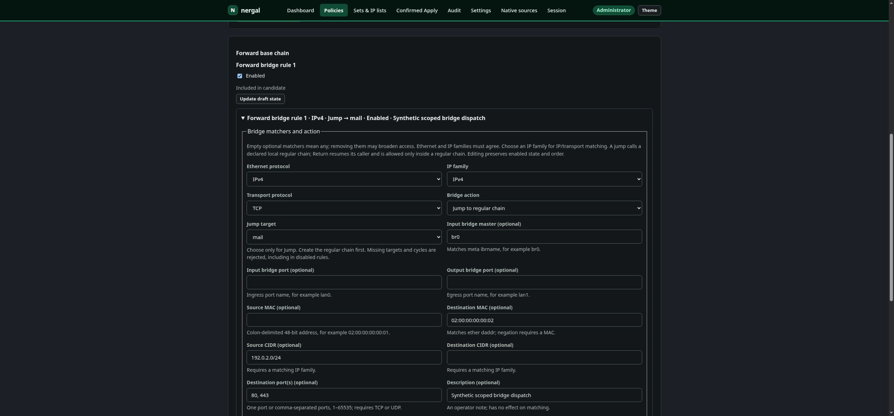
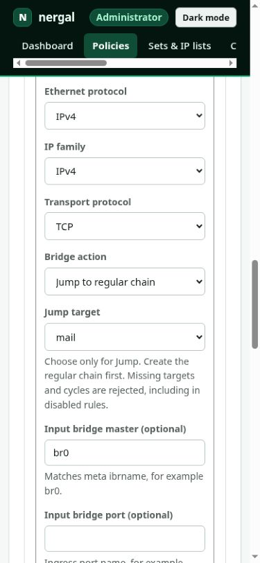

# Guided router conditions and postrouting

In **Policies → Filter**, add or edit a normal rule, then expand its panel under
**MAC, negation & meter conditions**. This separate form preserves the rule's
addresses, ports, pinned list versions, description, position and enabled state.

- Enter one source MAC or a comma-separated list (up to 64 distinct addresses).
  Empty removes the MAC restriction. MACs identify the Ethernet sender visible to
  the firewall; they do not identify a remote sender across routed networks.
- Select **Except** to negate the corresponding matcher. An IP/interface/MAC
  matcher must exist before it can be negated. A pinned address list can be
  negated without replacing its immutable reference.
- Configure packets, burst and timeout using the ordinary rule editor first;
  then select a **Per source address** or **Per destination address** bucket.
  Destination buckets share a limit across callers reaching that destination.
- **Reject — ICMP admin prohibited** is an explicit filter verdict. The native
  candidate uses `reject with icmpx type admin-prohibited`; drop remains separate.

In **Policies → NAT**, use **Add postrouting rule** or expand an existing
postrouting editor below the table. These full-width forms expose:

- **SNAT** with an explicit translated IP matching the rule family;
- **Masquerade**, which uses the output-interface address;
- **Return**, which stops this NAT chain without translation;
- optional source/destination CIDRs, input/output interfaces and their negation;
- any/TCP/UDP protocol and optional TCP/UDP destination port or port list.

Leave the translated address empty for masquerade and return. Incompatible fields
are rejected rather than discarded. Empty optional matchers mean any; clearing a
matcher can broaden traffic. Return exemptions normally precede translation rules.
Editing retains the rule's enabled state and position; adding appends an enabled
rule. Removing a rule is a separate operation.

Every successful submission updates only the draft. Review the intent and native
diffs, save an immutable revision, then use confirmed apply for an explicitly
selected host. These HTTP endpoints cannot invoke the privileged agent. They
require Administrator authorization and antiforgery tokens, reject unknown and
duplicate fields and malformed checkbox values, and compile the entire policy,
including dormant rules, before returning an updated draft. Auditors remain
read-only. No previously saved revision changes during editing.

## Raw prerouting and MSS

In **Policies → Filter**, **Raw prerouting & reverse-path filtering** creates the
optional `rpfilter` chain with `hook prerouting priority raw`. Its default is
explicitly selectable as accept or drop. Accept in this early hook continues to
later hooks; it does not override ordinary filter drops. A drop default can
interrupt traffic before ordinary filter rules run.

Expand **Add raw prerouting rule** to choose either/both IP families, protocol,
source CIDR and ingress restriction/negation, source/destination ports, verdict,
and the failed reverse-path lookup matcher (`fib saddr . iif oif == 0`). A source
CIDR requires a single matching IP family; ports require TCP or UDP. An intentional
DHCP exception can use UDP source port 68. Scope exceptions carefully and move
them ahead of a FIB drop using the raw rule's up/down controls. Raw edits and moves
preserve enabled state. Remove rules individually before removing an empty raw
chain; removing a drop-default chain can broaden access.

**Forward TCP MSS clamping** configures an explicit size in the supported
536–1460-byte range, for forwarded SYN packets in both IP families. It does not
accept traffic. Resizing preserves a configured clamp's enabled flag. Use the
separate Enabled control to disable while retaining the size, or **Remove MSS
configuration from draft** to remove it explicitly. Adding a new clamp enables it.

## DNAT conditions and NAT order

In **Policies → NAT**, **DNAT negation conditions** changes source, original
destination and input-interface negation without replacing translation settings,
ports, order or enabled state. Source and interface negation require an existing
matcher. Existing basic edits preserve these flags and still reject removal of a
matcher while its negation remains set.

DNAT and postrouting table up/down buttons move a whole rule by one position,
including its disabled flag and every matcher. Place return exemptions before
translation rules as required by the intended policy. Reordering remains a draft
change and must pass the same revision review and confirmed-apply workflow.

## Auxiliary inet table

**Policies → Filter → Auxiliary inet filtering** configures the optional owned
`inet nergal_aux` table. Select a priority in -300..300 (the form starts at -5) and
explicit input/forward/output defaults. Lower priorities run first; an auxiliary
accept does not override a later base-chain drop. The table uses the existing
complete ownership/observation, atomic candidate and independent rollback boundary.
It never adopts or edits a foreign table.

Create the table before adding rules. Each auxiliary rule has a complete guided
form for chain, family, protocol/verdict, CIDR/port sets, ICMP type, interfaces,
connection states, original DNAT status, source MACs, negation and source/destination
rate limits. Edits retain enabled state and existing list pins; up/down controls
move the whole rule. Library attachment workflows support primary and auxiliary inet
filter rules. Postrouting and bridge address/port lists have contextual selectors;
DNAT address references and native named objects remain M3 work. Raw and MSS constructs
belong to the primary filter table and are rejected in auxiliary intent.

Remove auxiliary rules individually before removing the empty table. Removing the
table also removes its chain defaults and may broaden traffic. All settings and
rule submissions remain unsaved drafts until revision review/save and confirmed
apply. No other policy section changes when an auxiliary rule is edited.

## Complete bridge rules and local regular chains

**Policies → Bridge** configures the optional owned `bridge nergal_bridge` table,
forward hook priority (-300..300) and unmatched-frame verdict. The initial priority
is -200; -5 is also supported. Create the table, then add local regular chains by
name before adding jumps. Names contain 1–32 ASCII letters, digits or underscores,
start with a letter, and cannot be `forward`.

The forward and each regular-chain panel expose complete rule forms for Ethernet
protocol, input bridge master (`meta ibrname`), ingress/egress bridge ports, source
and destination MACs/negation, IP family/prefixes, TCP/UDP destination ports, and
accept/drop/jump/return. Ethernet and IP families must agree. IP-prefix matching requires a matching IP family; transport matching can cover
both families. Jump requires a declared local target; other actions
require an empty jump selection. Return resumes the caller and is allowed only
inside regular chains. Reaching a regular chain's end also resumes its caller.

Each existing rule has an inline enabled control and a complete editor. Edits and
up/down moves retain enabled state, matchers, descriptions and order. Rule action
labels show Jump/Return explicitly, rather than presenting their neutral internal
verdict as a drop. Auditors can expand disabled read-only fields to inspect complete
matching and control flow. Server authorization still independently denies writes.

Missing/cyclic targets, excessive nesting, incompatible family/protocol/MAC fields
and malformed form values are rejected across the whole draft, including disabled
rules. Remove incoming jumps and chain rules before deleting a regular chain;
remove forward rules and regular chains before removing an empty bridge table.
Removing the table also removes its default policy and can broaden access.

Structured forms now cover the supported policy constructs. M3 still tracks
additional reusable-object scope/native-object semantics; M4 tracks semantic
native import/export. Broader navigation, performance and UX refinement remain M5.
All enforcement still requires immutable revision review and confirmed apply. The advanced JSON editor remains available for
supported constructs without guided forms. This is not general native
`nftables.conf` conversion; semantic import/export remains M4.

## Verified appearance

These screenshots use synthetic addresses and private disposable test state.
They show the UI, not evidence of packet enforcement.

Postrouting source/destination fields accept one CIDR or bounded, distinct,
disjoint/non-adjacent same-family CIDR lists. Pinned address fields show their
immutable contents read-only. Choose source/destination/ports in **Reusable
postrouting lists**; explicit removal clears address negation too, but cannot
remove the only required source restriction from explicit SNAT.

Bridge source/destination fields also accept comma-separated CIDRs. For reusable
address lists, choose the rule's IP family and attach a version in that chain's
reusable-list selector. Pins show their exact contents read-only; ordinary edits
preserve MAC restrictions, list versions, order and enabled state. Explicit removal
clears only that IP matcher. Review the resulting access change before saving.

DNAT's **Original destination port(s)** field accepts one port or a comma-separated
set. Its reusable selector pins a Port-list version, displayed read-only during
ordinary edits. Matching precedes translation; every listed port uses the same
explicit translated target. Removing a pin clears only that original-port
restriction. Invalid/duplicate/unknown form fields are denied instead of accepting
binder defaults that could broaden a rule.

DNAT edits expand beneath the table so pinned contents and guidance remain readable
on desktop and mobile. Table edit links lead to each form; saving stays explicit.
