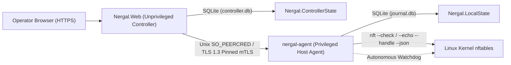

# nergal

**nergal** is a self-hosted `.NET 10` firewall controller and privileged Linux `nftables` agent built around explicit resource ownership, atomic multi-table candidate validation, and independent local timed rollback.

## Product scope

Nergal is being developed as a fully functioning, general-purpose FOSS firewall
manager for independent single-host and multi-host installations. The initial
private deployment supplies migration acceptance cases; reusable contracts,
synthetic public tests and UI workflows serve operators with other network layouts.
Basic installation does not require a particular identity provider, VPN or hosting
service. Migration is optional: operators must also be able to author new policies
through the UI. This is the product direction, not a claim that every planned
workflow is complete.

The [native source library](native-source-library.md) accepts `nftables.conf` uploads
into immutable database history and downloads exact originals. The [typed sets/IP lists
library](reusable-object-library.md) supports creation, edits, search and immutable
history, with pinned references across the declared rule scopes and saved revision
impact visibility. [Native static sets](native-static-lists.md) now retain named
lookups and complete receipts. Semantic conversion and generated policy export remain planned. Shared object changes require visible reference/impact review and
immutable saved revisions. File import must report unsupported semantics explicitly;
source ingestion and lexical inspection are not semantic policy conversion. Generated export identifies the
selected managed revision and scope. Per-rule inline enable/disable controls and
contextual accessible form hints are also planned authoring requirements. The database
is intended to be the rolling source of truth for application-managed state and
history; additional SQL backend migrations follow logical schema stabilization. See [migration and authoring status](router-migration-and-sandbox.md).

## Core Design Principles

- **Native `nftables` first**: Compiles directly to canonical `inet nergal_filter`, `inet nergal_nat`, and `bridge nergal_bridge` tables without shelling out untrusted strings or flushing foreign tables.
- **Explicit process & privilege separation**: The unprivileged `Nergal.Web` controller (ASP.NET Core MVC + Blazor) holds zero `CAP_NET_ADMIN` privileges and never touches the kernel directly.
- **Two-phase confirmed apply**: Every live change arms an independent local watchdog (`nergal-agent watch`) before replacing rulesets; missed confirmation triggers autonomous kernel rollback.
- **Fail-closed verification**: Ownership comments (`nergal:v1:<owner>:<resource>`), boot/namespace-bound receipts, auxiliary table presence checks, and `SO_PEERCRED` / pinned TLS 1.3 mTLS authentication reject ambiguity rather than guessing.

## Quick Navigation

| Topic | Description |
| --- | --- |
| [Architecture & Trust Boundaries](architecture.md) | Process isolation, security boundaries, and two-phase apply lifecycle. |
| [Policy Reference](policy-reference.md) | Schema 1/2 filter rules, inline CIDR/port sets, ICMPv4/ICMPv6, NAT, and Bridge bundles. |
| [Agent & Control Protocol](agent-and-protocol.md) | Framing, Unix/TLS transports, multi-table receipts, and rollback semantics. |
| [Web Controller & RBAC](web-controller-and-rbac.md) | Visual rule builder, local sessions, optional OIDC, RBAC roles, and audit log. |
| [Deployment & Packaging](deployment-and-packaging.md) | Systemd units, sysusers/tmpfiles, `.deb`/`.tar.gz` packages, and offline setup. |
| [Testing & Conformance](testing-and-conformance.md) | Deterministic unit tests and disposable user/net namespace packet verification. |
| [Release Notes](release-notes.md) | CalVer releases and changelog highlights. |

## Unreleased router and settings work

See [Router Migration & Local Sandbox](router-migration-and-sandbox.md) for the
current support matrix, supported apply scope and recovery limits, saved-settings/runtime distinction,
private source inspection, container isolation, verification limits, and screenshots.
This local development work is not a published release.

See [Milestones to Product Code-Complete](milestones.md) for the remaining work and
completion gates. Historical foundation releases do not establish product-wide
code-complete status.
