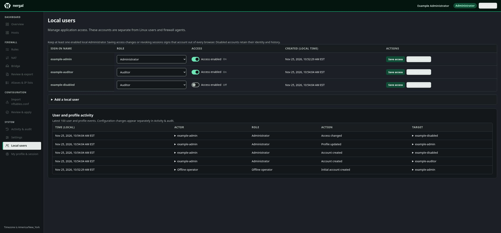

# Local users and personal profiles

Local users are application identities, separate from Linux accounts and enrolled
agents. A trusted operator initializes the private account database and provisions
its first account once. Administrators then use **System / Local users** for
routine access management. There is no public registration or password recovery.
This unreleased schema targets fresh installations; no previous account-store
version is adopted, migrated or reset by the application.

## Access management

- Create an explicitly named local Administrator or Auditor. Names use 1–64 ASCII
  letters, digits, dots, underscores or hyphens and are case-insensitive. Initial
  passwords use the existing Identity hasher and 15–128 Unicode-character bounds.
- Change a role or use the switch in **Access**, then choose **Save access**. Disabling retains
  the account identity, profile and history. It blocks password sign-in and
  invalidates existing tickets; reenabling cannot resurrect old tickets.
- Keep at least one enabled local Administrator. The check runs inside the same
  serialized transaction as the change. Concurrent self-demotions cannot remove
  the last Administrator. External group membership is not counted as a local
  recovery account. A deliberately Auditor-only bootstrap cannot manage users.
- **Revoke sessions** rotates the selected account's stamp without resetting its
  password. Security changes and password changes also revoke affected tickets.
  An already-authorized request may finish, but a subsequent mutation rechecks a
  local actor's current stamp, role and enabled state under reservation.
- Expected versions reject stale forms. Unknown/repeated fields, unsupported roles,
  absent CSRF and unauthorized callers cannot change account state. The current
  installation limit is 256 local accounts.

Auditors can edit their own profile and local password. They cannot list other
accounts or read identity audit. Local account deletion and remote credential
reset are not exposed. Credential changes are explicit local-user operations;
none modify production accounts automatically.

## Profiles and credentials

**System / My profile & session** shows the verified sign-in name and role
separately from optional display-name, given-name, family-name and profile-email overrides. The override is database-backed,
versioned, escaped on output and used in the desktop profile link. It cannot grant
a role or change/link identity. Blank fields use current provider defaults; display name falls back to the verified identity name. Profile email does not verify delivery or enroll MFA. Names
can contain up to 80 Unicode characters, with malformed Unicode/control characters
denied. Profile reads do not create rows or audit entries.

Profiles use canonical local UUIDs or exact validated OIDC issuer/subject identity.
Equal display names or email claims cannot merge identities. Existing OIDC users
can save their own local override; their credentials remain at their provider.

A local password change requires the current password. Incorrect verification
persists lockout accounting even when the HTTP caller disconnects. Successful
change revokes old tickets, clears the browser cookie and returns to sign-in.
Both sign-in and password-change endpoints have independent process-wide limits
of ten submissions per minute; per-account failure lockout remains independent.
Passwords never enter view models or audit events.

## Storage and audit

The private credential database uses account schema 4 with explicit role claims,
per-account state, personal profiles and append-only identity audit. Mappings and provider observations remain separate from local metadata overrides. The former
singleton slot is removed. Missing roles fail closed; there is no implicit
Administrator default. Initialization creates no user; offline provisioning remains
one-time bootstrap even though authenticated management can add more accounts.
Ordinary startup refuses old/unknown or incomplete storage.

**Local users / User and profile activity** shows the latest 100 identity events.
Account changes, stamp rotation and identity audit commit atomically in the same
protected account store. They are not falsely presented as one transaction with
`controller.db`. Configuration history remains under **Activity & audit**. Audit
rows contain identifiers, stable actions and UTC instants, not passwords/hashes.
Update/delete triggers and their definitions are checked. Displayed timestamps
use the browser timezone and retain explicit UTC details.

See [ADR 0058](https://git.lantea.one/lantea-one/nergal/src/branch/main/docs/decisions/0058-local-users-and-profile-boundary.md),
[local sessions](https://git.lantea.one/lantea-one/nergal/src/branch/main/docs/local-sessions.md) and [private credentials](https://git.lantea.one/lantea-one/nergal/src/branch/main/docs/local-administrator-accounts.md).
The existing private-path, protected-key, fifteen-minute session, CSRF and Linux
process/agent boundaries remain in force.

## Remaining M5 identity gates

This slice does not complete M5. Signed OIDC profile defaults and per-field local overrides are implemented in
[OIDC profile defaults](oidc-profile-defaults.md). Runtime provider configuration,
generic OAuth and LDAP profile mapping remain required. LDAP must
support direct sign-in. Local email and TOTP/authenticator MFA, administrator
email-delivery screens, optional enrollment with Administrator/all/neither
requirement policy, and explicit per-provider federated bypass with optional
assurance claims remain open. LDAP sign-in follows local MFA requirements.
These integrations must preserve identity/authority separation and receive their
own failure, replay, TLS and authorization acceptance before being advertised.

Browser page navigation redirects to sign-in when a session is required. API
clients keep status-code responses. Themed 403/404/503 pages retain the original
status and offer a fixed local recovery link without showing exception details.
They render without profile-store dependencies. The main content uses the width
beside the icon-based sidebar, with centered browser timezone at the sidebar bottom
and no page footer. Profile sections adapt to that space; shared form fields use
consistent surfaces, sizing, hints and focus/error states.

## Screenshots

These screenshots use an isolated synthetic installation. They contain no private
server exports, credentials or production accounts.

[Light theme](assets/screenshots/m5-users-light.jpg),
[personal profile](assets/screenshots/m5-profile-light.jpg),
[dark profile](assets/screenshots/m5-profile-dark.jpg),
[mobile profile](assets/screenshots/m5-profile-mobile.jpg),
[mobile navigation](assets/screenshots/m5-navigation-mobile.jpg) and
[error recovery](assets/screenshots/m5-error-dark.jpg) show the shared UI.

The same control appears in [dark settings](assets/screenshots/enablement-settings-dark.jpg)
and [light settings](assets/screenshots/enablement-settings-light.jpg).
