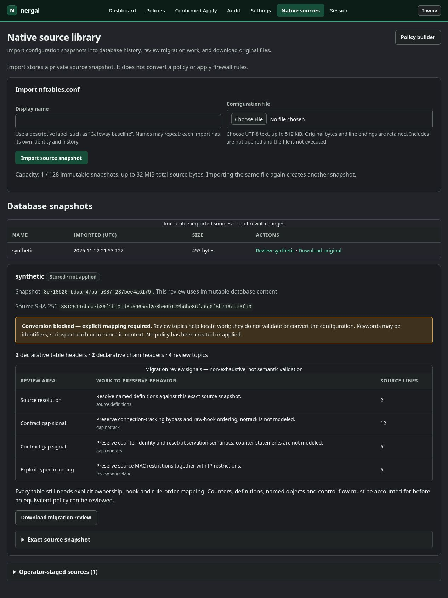
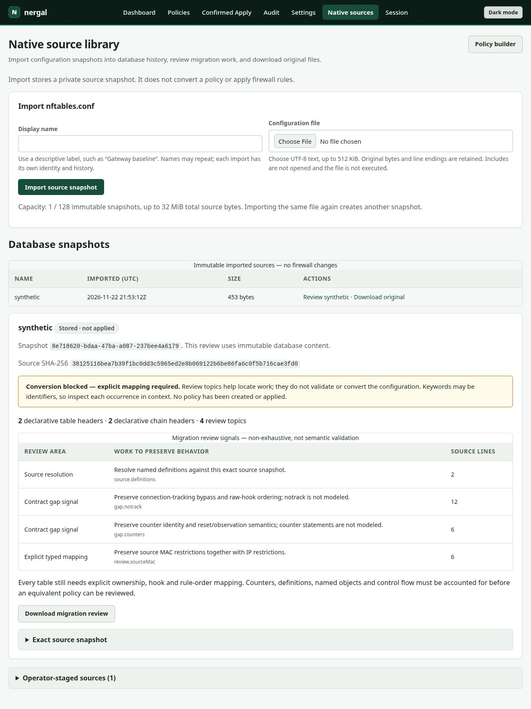

# Native source library

The administrator-only **Native sources** screen accepts UTF-8 `nftables.conf`
uploads into immutable controller database history. Supply a display name and a
file; field hints explain the limits. Uploads do not execute nft, resolve includes,
create managed policies or change firewall rules.

Each import receives an independent identity, attributed audit event, UTC time,
exact byte length and SHA-256. Times are stored in UTC and displayed in the
viewer's browser timezone, named in the page footer; the tooltip retains UTC. Repeated names or identical contents remain separate
snapshots. Select **Review** for one source's exact text and non-exhaustive migration
review. **Download original** returns its exact bytes, including BOM and line endings,
as `nftables.conf`. The JSON review download uses the stored source identity.
Semantic conversion remains unfinished. [Saved revision exports](policy-exports.md)
provide separate native and complete intent files from selected database revisions.

## Persistence and limits

Source bytes and metadata live in `controller.db`; listing loads metadata only.
Selected content is checked against its stored length and digest before use.
Immutability triggers block updates/deletes and their definitions are verified.
The initial retention limits are 128 records and 32 MiB, with 512 KiB per source.
No deletion or retention-policy interface is implemented in this slice.

Anonymous users and Auditors are denied. Imports require Administrator role and
CSRF. Invalid UTF-8, unsafe display names, extra/ambiguous fields, multiple files,
file/request limits and capacity exhaustion are rejected without partial imports.
Uploaded filenames never select paths. Raw source views are read-only.

An optional operator directory provides staging snapshots. **Import staged …**
copies a selected snapshot into database history; later file changes cannot update
that record. A basic installation requires no staging directory or site integration.

## Existing databases

New controller stores use schema 3, including the typed list library. Stop the controller and make a verified SQLite
backup, including any uncheckpointed WAL data, before upgrading an existing schema-1/2
store under its owner identity:

```sh
nergal-admin controller upgrade ABSOLUTE_CONTROLLER_DIRECTORY
```

The web host does not silently upgrade. The explicit operation is atomic and
idempotent, retains hosts/settings/policy revisions/audit, and rejects unknown
versions, source-table collisions and invalid protection definitions without repair.
Agent journals and account stores are not changed. The isolated local sandbox stops
its own writer and performs this offline step through disposable provisioning.
Migrations for additional SQL engines remain deferred until schema stabilization.

## Verification

Real SQLite tests cover exact bytes, independent identities, atomic audit failure,
role/capacity denial, immutable protections, corruption and upgrades. HTTPS checks
exercise upload/staging/download, persisted data after restart, source escaping,
CSRF, encoding/size limits and anonymous/Auditor denial. Existing packet and rollback
checks remain separate evidence; source ingestion is not conversion equivalence.

## Appearance

These captures use a separate synthetic-only controller database and staging source.
They contain no private server exports or topology.






