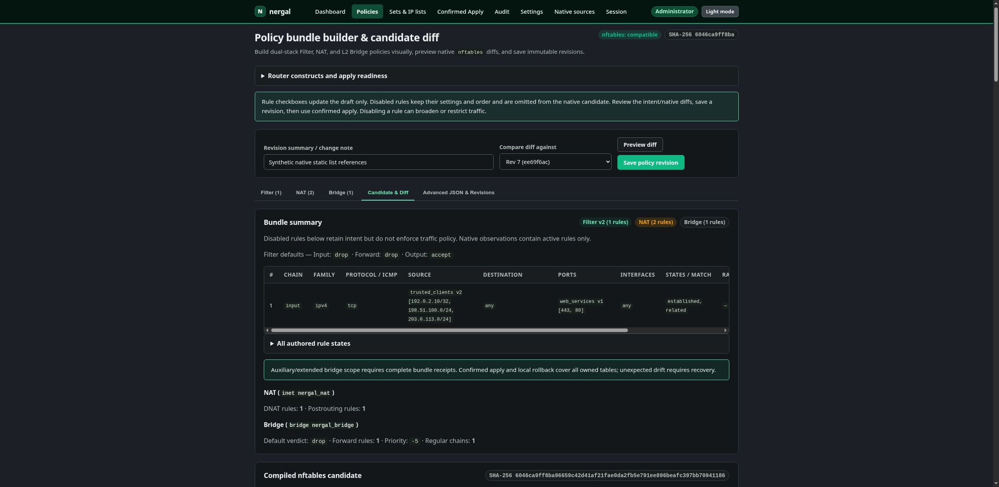
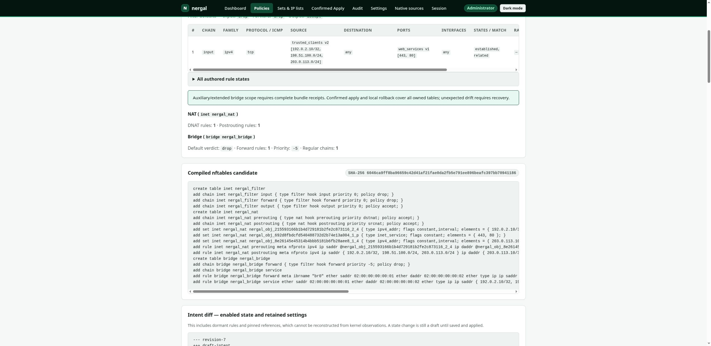
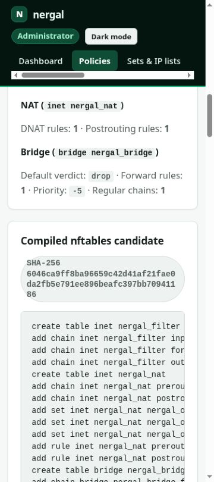

# Native static list references

New **Attach selected version to draft** actions use shared native static sets for
IPv4, IPv6 and port lists. A table declares each referenced object/version/type
once; its rules retain named lookups. The same version can be used by several
rules without duplicating its native definition. Separate tables have separate
owned definitions. Earlier saved references keep their existing literal projection
and exact compiled artifacts. Reattaching a version changes the draft explicitly;
ordinary edits, reorder and enable/disable preserve the selected projection.

## Workflow and scope

Create a list in **Sets & IP lists**, attach an explicit version in **Policies →
Reusable list references**, inspect the generated candidate/diff, save a revision,
then use confirmed apply. Editing the library never updates saved revisions or a
running firewall. New UI attachments work in every declared reference scope:

| Scope | Address slots | Port slot |
| --- | --- | --- |
| Primary and auxiliary inet filtering | Source, destination | Destination ports |
| DNAT | Source, original destination | Original destination ports |
| Postrouting NAT | Source, destination | Destination ports |
| Bridge forwarding and regular chains | Source, destination | Destination ports |

Family, transport, literal conflicts, distinctness, disjoint/non-adjacent prefix
constraints and dormant-rule validation remain unchanged. Singleton lists retain
a native set too. Existing whole-matcher negation applies to the complete lookup
where the rule contract supports negation. NAT translation remains one explicit
address/optional port. Removing a reference clears only its matcher and negation;
removing a required DNAT destination or explicit-SNAT source is denied.

Static definitions are constant. Updates create a new immutable controller version
and a reviewed replacement revision; the browser cannot modify live set elements.
Generated identifiers bind UUID, version and type. Controller names/descriptions
remain in protected revision intent; native observation reconstructs enforcement
identity and contents without claiming to recover controller descriptions.

## Complete observation and receipts

Terse native listing omits static elements as well as dynamic meter contents. The
agent therefore collects complete individual listings for recognized static sets
in fixed owned tables. Definitions/handles must agree. The entire collection must
remain within one kernel transaction generation, under the resource execution lock.
Dynamic meters retain their separate bounded observation contract; runtime entries
are not read as static policy or included in static receipts.

Some nft userspace releases omit low IPv6 interval elements, including `::1` and
`::/64`, from creation echo. The agent retains the original creation handles and
lookup evidence, verifies complete generation-bound listings against the exact
independently protected artifact, checks all emitted elements against those
listings, then completes only missing element evidence. Full parsed echo/list
fingerprints must still match. Missing creation definitions/handles, conflicting
contents or a different artifact are denied. The journal independently repeats
artifact verification before binding apply, rollback or recreated-boot receipts.
See [the source decision record](https://git.lantea.one/lantea-one/nergal/src/branch/main/docs/decisions/0048-native-static-list-references.md).

Receipts include every static definition's handle, type, flags, canonical contents
and every rule-handle/matcher/name binding. Replacing a lookup with equal literals
changes the receipt. Unknown, unused, incomplete, conflicting or ambiguous native
objects fail closed. Protected ownership, checked atomic replacement and the
independent timed watchdog remain required. Outside privileged writers remain
unsupported; generation checks do not provide kernel compare-and-swap.

## Bounds and support limits

Lists contain 1–64 entries. Each table allows at most 64 active native definitions.
A conservative creation-echo budget, including the complete bundle, must fit the
existing 64 KiB observation bound before any mutation. A valid but too-large graph
returns `object.nativeObservationTooLarge` with no candidate. Set reads share a
ten-second complete-collection deadline. These limits can be reached before the
individual list or rule-count limits; generated source size alone is insufficient.

This slice supports generated static IPv4/IPv6/port objects referenced by supported
rules. Standalone unused declarations, arbitrary native identifiers/types, maps,
concatenations, dynamic flags/timeouts and named MAC sets are not added. Existing
MAC literals/anonymous sets and dynamic rate-limit meters retain their own support.
The [source conversion workflow](native-source-library.md) supports declared static sets; unsupported source objects block conversion. [Saved revision exports](policy-exports.md)
provide native candidates and complete intent as separate files. Native support
does not turn source inspection or original-file download into semantic conversion.

Upgrade the controller and agent together. Older codecs reject the new `nativeSet`
reference flag. Policies without it retain legacy projection and fingerprints;
this change requires no SQL schema migration.

## Screenshots

The synthetic saved DNAT revision below retains three immutable list pins through
ordinary form editing and emits three native definitions with named lookups. Other
sections retain their earlier projection, demonstrating mixed revision compatibility.
These screenshots show authoring/review; they do not represent a production apply.

The 375-pixel mobile check keeps the digest inside the card and long code lines
inside the code panel's horizontal scroller. Pinned form fields remain read-only.

