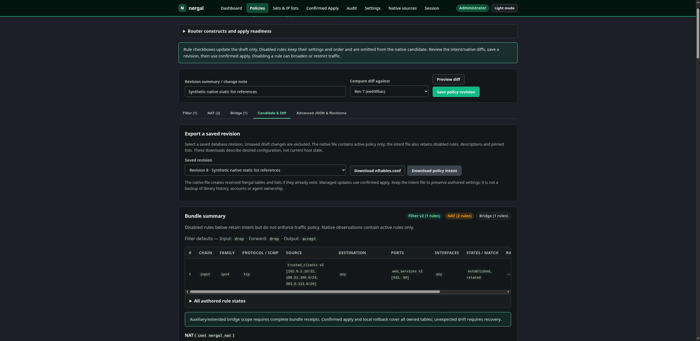
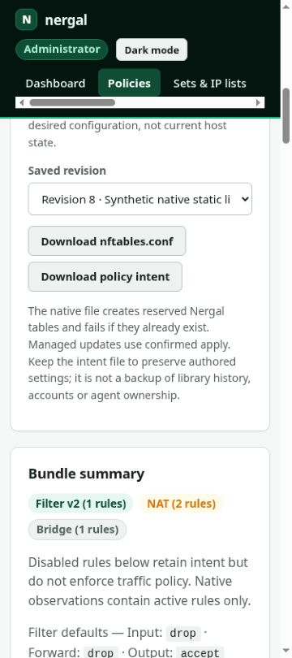

# Saved policy exports

Administrators can open **Policies → Candidate & Diff → Export a saved revision**,
choose a revision, and download its native configuration or complete policy intent.
The selector always names a saved database revision. Previewing or editing a draft
does not change either download; save a new revision before exporting those changes.
Auditors can review policies but cannot use these export endpoints.

## Choose the appropriate file

| Download | Contains | Does not contain |
| --- | --- | --- |
| `nergal-revision-N-nftables.conf` | Exact deterministic UTF-8 create-only native candidate for every table in revision N; active matchers, verdicts, ordering and referenced native static sets | Disabled rules, authored descriptions, controller reference metadata, ownership markers, handles or observed/runtime state |
| `nergal-revision-N-policy.json` | Canonical full typed intent, including disabled rules and MSS state, descriptions, ordering and pinned list identities, versions, contents and native/literal projection | Complete library history, source originals, hosts, accounts, settings, audit history or protected agent receipts |

The SHA-256 of the native file's exact bytes equals the saved candidate digest.
Repeated downloads are byte-identical; there is no export-time timestamp or host
identity in the generated candidate. Both files derive from the selected saved
contents, even after a newer revision or list version exists. Changes to dormant
intent can change the JSON while leaving the native file unchanged.

The native file creates reserved Nergal tables and fails if a table already exists.
It contains no flush/delete commands and does not replace existing tables. Use
the application's reviewed, confirmed apply workflow for managed updates; a
download grants no ownership or apply authority. Neither file reports what a host
has actually applied or is currently enforcing.

Keep the intent file when retaining authored settings. It can be reviewed in the
existing **Advanced JSON & Revisions** code editor and saved through normal policy
validation. Referenced list identities/versions must exist with matching immutable
contents in the receiving controller. This is not an automatic cross-controller
library migration or a complete backup. An nftables file alone cannot reconstruct
disabled rules, authored descriptions or all controller metadata.

## Verification and limits

The server re-decodes and compiles the complete saved bundle and checks the result
against its persisted candidate digest before producing either attachment. Unknown
or invalid intent, unsupported semantics or digest mismatches return
`export.revisionInvalid` (HTTP 409), without a partial download. Missing revisions
return 404 and malformed/out-of-range identifiers return 400. Anonymous requests
return 401; Auditor requests return 403. Responses are not cached.

Exports use the unprivileged pure compiler. They perform no shell, agent, kernel
or filesystem source operations and do not create or modify database revisions.
They are separate from [exact original-source downloads](native-source-library.md),
which preserve uploaded bytes, BOM and line endings.

M4 remains open for semantic conversion of ordinary native files, explicit include
resolution, persisted mappings/gaps and independent round-trip/packet acceptance.
Lexical source review is not conversion. See [the milestone gates](milestones.md)
and [ADR 0049](https://git.lantea.one/lantea-one/nergal/src/branch/main/docs/decisions/0049-saved-revision-exports.md).

## Screenshots

These captures use a separate synthetic controller database, including a disabled
filter rule and native DNAT list references. No private source or credential is
shown. Browser downloads matched the selected saved artifact digest and retained
disabled intent. The mobile controls fit a 375-pixel viewport without page overflow.

