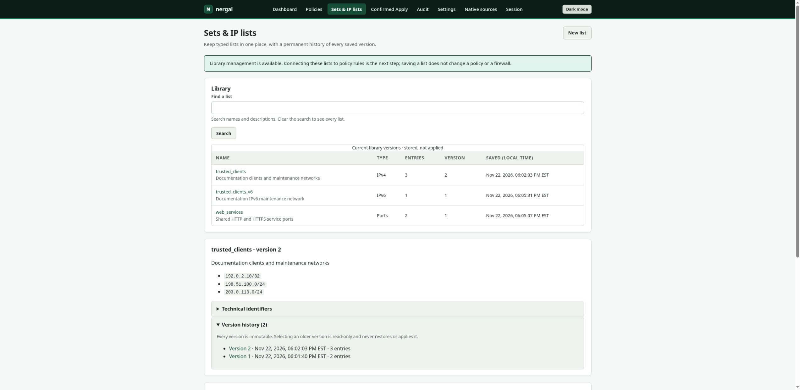
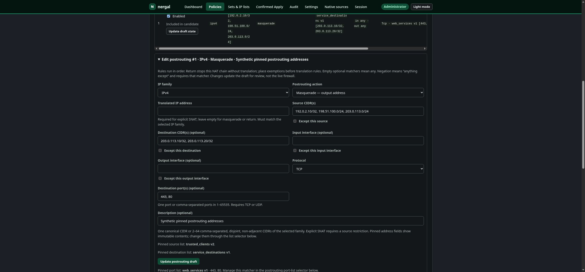
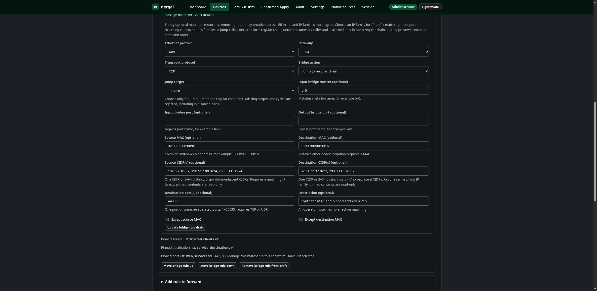
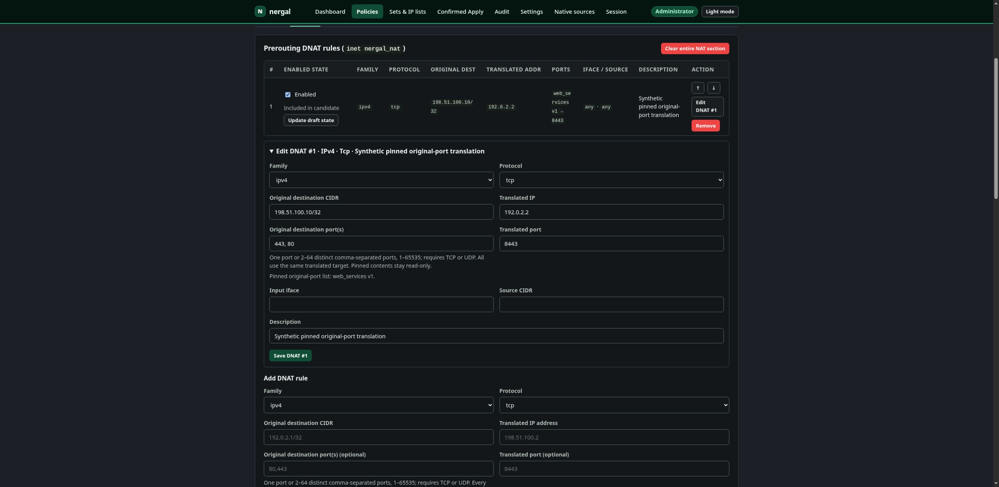
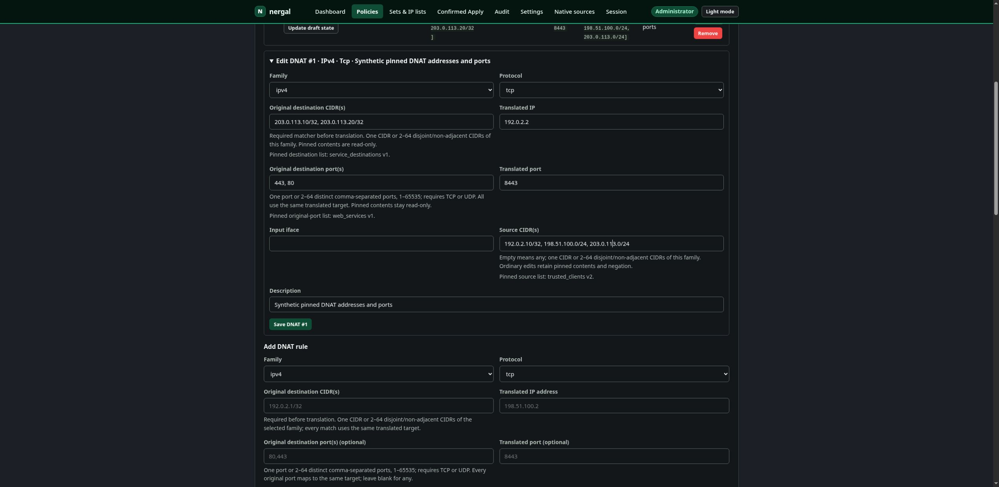

# Sets & IP lists

The **Sets & IP lists** screen provides a database-backed library of typed IPv4,
IPv6 and transport-port lists. Administrators can create, describe, search and edit
lists without JSON. Auditors can inspect current contents and version history.

## Create and maintain a list

Choose **New list**, enter a unique lowercase name, choose a type and add 1–64
entries, one per line. Field hints explain the format and limits. Addresses become
canonical CIDRs; CIDRs must have zero host bits. Ports are individual integers from
1 to 65535. Mixed families, hostnames, scoped/mapped addresses, ranges, duplicate
canonical entries, dynamic flags and timeouts are rejected explicitly.

Each save appends an immutable version and audit event atomically. Object names,
types and identities remain fixed. Historical views are read-only; they do not
restore or apply a list. Stale edits return a conflict and retain your input so
you can compare with the current version. There is no forced overwrite or deletion.
Times remain UTC in storage and appear in your browser's timezone with its name
in the footer.

## Pinned policy references

In **Policies → Reusable list references**, use the primary or auxiliary inet form and choose a rule,
source/destination/port matcher and the displayed list version. **Attach selected
version to draft** explicitly replaces that matcher's literals or prior reference.
Inspect the rule summary/native diff, save a revision, then use confirmed apply.
**Remove reference from draft** clears the matcher and its negation, which can
broaden the rule; it leaves no hidden literal copy.

Policy JSON retains identity, version, contents and digest. Saved revisions never
fetch the latest list contents. Library edits create new versions without changing
existing policies or firewalls. The detail page shows saved revision references,
including older versions; these are not active-host usage counts. Ordinary rule
editing and reordering preserve references. Metadata-only changes remain visible
in the reference summary even if native text is unchanged.

Compilation projects each immutable snapshot onto the existing scalar/anonymous-set
matcher contract. **Native named sets, maps, dynamic flags,
timeouts and native named-object import remain unsupported.** Family/protocol and
literal conflicts, missing/forged snapshots and unsupported overlap/adjacency fail
explicitly. Single-element lists use scalar matching. The UI selectors edit primary and auxiliary inet filter rules through separate
explicit forms. Existing API submissions without a scope still select primary
filtering; query parameters cannot select an auxiliary target. Updated
controller and agent builds are required; older codecs reject unknown fields.

The library retains at most 128 lists and 64 versions per list. Descriptions are
plain text up to 500 characters. Database protection definitions and content digests
are validated; a failed save leaves no partial list or audit event.

New controller stores use schema 3. Existing schema-1/2 stores require the explicit
offline `nergal-admin controller upgrade ABSOLUTE_CONTROLLER_DIRECTORY` after
stopping the writer and taking a verified SQLite backup. Sources, policies, hosts,
settings and audit history are preserved. The web process never migrates a database.
Additional SQL backends remain deferred.

## Appearance

These captures use a separate synthetic-only controller database. They demonstrate
library management, pinned references, hints and local times. Independent disposable
namespace tests verify dual-stack matching and agent rollback for static resolved
references; these screenshots do not establish native named-set support.

Auxiliary selection uses the existing database schema and immutable reference
contract. Usage paths include `auxiliaryFilter.filter.rules[n]`. Native named sets,
Native named and dynamic objects remain separate M3 work.

## Postrouting and bridge port lists

**Policies → NAT → Reusable postrouting lists** and each **Policies → Bridge**
chain panel now select immutable Port-list versions for destination-port matching.
Attach replaces literal ports or a prior reference. Editing retains all other
matchers, actions/translation, jump/return, enabled state and order; ordinary port
inputs become read-only and show the pinned contents. Explicit removal clears the
port restriction and may broaden matching. Requires TCP/UDP; bridge IP-prefix
matching needs a family selection, while transport matching can cover both families.

References remain embedded in immutable revisions and verified against database
history. Library edits do not update saved policies. Usage paths include postrouting,
bridge forward and regular chains. Compilation projects a singleton to a scalar
and larger lists to existing anonymous port sets. This adds no native named objects,
rule expansion. Use updated controller and agent builds;
older codecs reject unknown reference fields. No SQL schema change is required.

## Compare versions before changing a pin

Open a list and use **Compare list versions**. Choose **From version** and
**To version**, then **Compare versions**. Either direction and same-version
comparisons are supported. The view shows added, removed and unchanged canonical
entries, description changes, each version's local save time and counts of saved
references to the compared versions. Revision links above the comparison identify
the matcher locations. Counts include historical revisions and dormant rules;
they are not active host or traffic measurements.

CIDRs are compared as exact stored entries, without calculating address coverage
or deciding whether access broadens. For example, replacing a `/64` with a `/48`
is one removed entry and one added entry. The surrounding policy matchers,
negation, rule order and verdict determine enforcement.

Each pinned reference in the policy summary includes **Compare current library
version with this pin**, opening a separate tab so an unsaved draft remains open.
Compare the immutable pinned version against the current stored version before
explicitly updating the reference in a draft. This read-only workflow is also
available to Auditors. It creates no list version, policy revision, audit event or
firewall apply; existing pins remain unchanged.

## Select a historical list version in a draft

In any supported reference form, choose a rule, matcher and list, then **Browse
selected list history**. This loads that list's immutable versions into the same
selector while retaining the table/chain, rule index, matcher, selected version,
revision comparison baseline and draft summary. It does not alter any rule or pin.
Only one list history is expanded at a time; other lists retain their current
versions, so the UI does not load every historical list snapshot.

Choose the desired displayed version and **Attach** it explicitly. The controller
validates its exact stored snapshot, matcher type and the complete policy. A newer
library edit cannot substitute its contents for the submitted old version. Ordinary
draft actions may reset selector choices to current versions; existing pins remain
unchanged. Browse history again to select another historical version.

Browsing requires the same Administrator/CSRF-protected draft form as attachment.
Auditors can inspect immutable history and comparisons in the library. Missing
versions, invalid targets, unknown/duplicate fields and invalid drafts are denied.
No version, revision, audit event or firewall operation occurs during browsing.
Older snapshots do not bypass compiler restrictions; inspect the draft and native
diffs, save a revision, then use confirmed apply.

## Pinned postrouting source and destination lists

In **Policies → NAT → Reusable postrouting lists**, choose a postrouting rule,
**Source address** or **Destination address**, then a same-family IPv4/IPv6 list
version. Browse history if an older snapshot is needed; attachment pins exactly
that displayed version. Attachment replaces the selected matcher's literals or
previous reference, retaining action/translation, ports, interfaces, negation,
order and enabled state. Preview/save verifies immutable database history.

The full postrouting editor also accepts literal CIDR lists. One entry is a scalar;
2–64 entries form an anonymous set. Every entry must match the rule family and
sets must be distinct, disjoint and non-adjacent so native observation preserves
the exact restrictions. Overlapping/adjacent lists can be stored but cannot be
attached when this native projection cannot round-trip them. No rules are expanded.

Pinned address fields show name/version and contents read-only. Ordinary guided
and legacy edits cannot silently replace them. Removing an address reference
clears that matcher and its negation; explicit SNAT still requires a source
restriction, so removing its sole source is denied. Masquerade/return may have an
unrestricted source. Review both intent and native diffs, save a revision, then
use confirmed apply. Saved usage paths include `nat.snatRules[n].sourceObject`
and `.destinationObject`; later library edits never change saved versions.

Canonical JSON retains `sourceObject`/`destinationObject`, or literal
`sourcePrefixes`/`destinationPrefixes`, exclusively with the corresponding scalar.
Native observations retain complete sets and use a v3 address-set fingerprint;
scalar/port-only receipt fingerprints stay unchanged. Older controllers/agents
reject the new JSON fields and cannot validate new receipts. Upgrade matching
controller/agent builds together. No SQL schema upgrade is required; the native
observation byte limit is unchanged. Native named sets/maps/dynamic objects,
Native named objects remain unsupported.

## Bridge address sets and pinned lists

Bridge forwarding and regular-chain rules support literal source/destination CIDR
sets and immutable IPv4/IPv6 library versions. Choose an explicit matching IP
family before attaching an address list. One entry compiles as a scalar; multiple
entries must meet the existing 2–64 distinct, same-family, disjoint/non-adjacent
prefix contract. Addresses remain conjunctive with MAC, EtherType, bridge-master,
interface and transport restrictions. A jump still calls its declared local chain;
a return still resumes its caller. Rule order and disabled state are retained.

Use each chain's reusable-list selector to attach, browse history or explicitly
remove a source/destination version. Guided edits keep pinned fields read-only;
removal clears only that selected IP restriction and may broaden access. Review
the complete intent/native diff and save a new revision before confirmed apply.
Saved usage includes both `bridge.rules[n]` and `bridge.subChains[n].rules[n]`
address paths. Later library edits cannot change saved snapshots.

Native observation binds every address-set entry in a v3 bridge fingerprint,
including handles and the complete chain graph. Scalar/port-only fingerprints
remain unchanged. Deploy matching controller/agent builds; older codecs reject
these fields. No SQL migration is required. Bridge IP negation, native named
sets/maps/dynamic objects remain unsupported.

## DNAT original-port lists

DNAT rules accept one original destination port, 2–64 distinct comma-separated
ports, or an immutable Port-list version. Matching happens before translation;
all original ports map to the same explicit translated address and optional port.
This does not map a list of original ports onto a list of translated ports.
TCP or UDP is required. Scalar, literal-set and reference forms are exclusive;
invalid disabled rules are rejected too.

Use **DNAT list references** to attach, browse history or remove a
version. Guided edits show pinned entries read-only and retain source/destination
restrictions, negation, ingress, translated target, order and disabled state.
Removal clears only the original-port restriction and can broaden matching. Review
the intent/native diff, save an immutable revision, then use confirmed apply.
Saved usage includes `nat.dnatRules[n].originalPortObject`; later library edits
cannot change a saved revision.

Strict JSON retains `originalPorts` or `originalPortObject`. Native echo/list
reconstruction preserves every original port; DNAT port sets use the complete v3
NAT fingerprint, while preceding scalar fingerprints remain unchanged. Upgrade
matching controller and agent builds together; no SQL migration is needed.
Native named objects and translated-port lists remain unsupported.

## DNAT address sets and pinned lists

DNAT source and original-destination matchers accept one CIDR, 2–64 distinct,
same-family, disjoint/non-adjacent CIDRs, or an immutable address-list version.
A singleton list projects to a scalar. Every match retains the single explicit
translated address and optional port; address lists describe matching before
translation and never become a list of translated targets. Negation applies to
the entire address matcher. Invalid disabled rules are rejected too.

Choose **DNAT list references**, select source/original destination/ports, then
attach a version or browse its immutable history. Ordinary edits keep pinned
fields read-only and preserve negation, original-port versions, translation,
ingress, order and enabled state. Removing a source pin clears only its matcher
and source negation. Original-destination matching is required, so removing its
sole pin is denied; replace that restriction explicitly or remove the rule.
Review intent/native diffs and save a new revision before confirmed apply.

Canonical JSON uses `sourcePrefixes`/`destinationPrefixes` or
`sourceObject`/`destinationObject`, exclusive with the corresponding scalar
`source`/`originalDestination`. Usage paths include both DNAT address slots, and
later library versions cannot mutate saved policy contents. Complete native
observations retain every prefix and negation in v3 NAT fingerprints. Existing
scalar/port-only fingerprints stay unchanged. Upgrade matching controller/agent
builds; no SQL migration is required. Native named objects and translated-target
lists remain unsupported. Source ingestion is still separate from semantic import.

