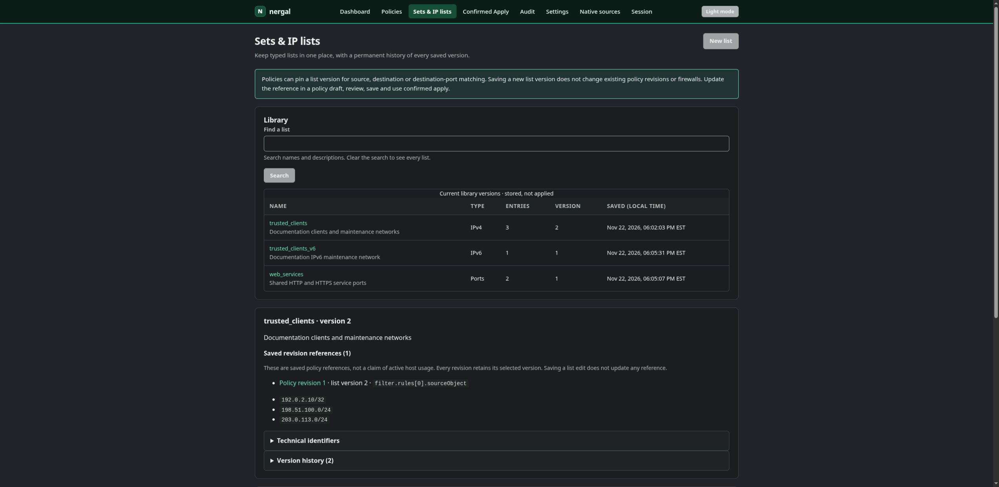
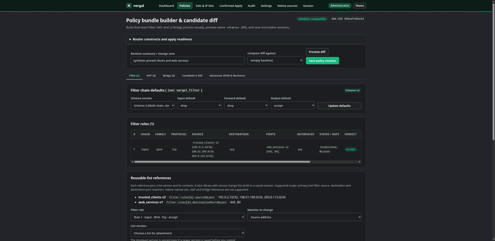
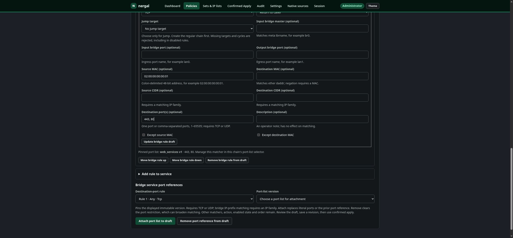
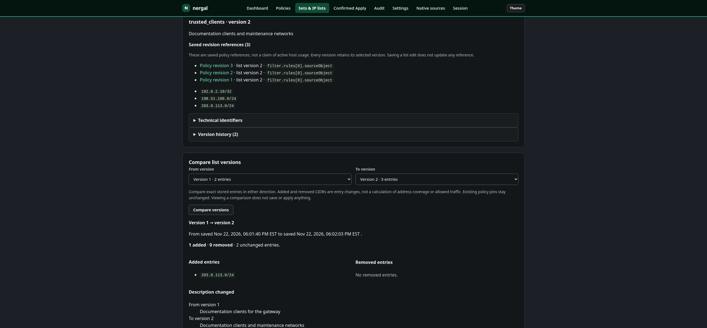

# Sets & IP lists

The **Sets & IP lists** screen provides a database-backed library of typed IPv4,
IPv6 and transport-port lists. Administrators can create, describe, search and edit
lists without JSON. Auditors can inspect current contents and version history.

## Create and maintain a list

Choose **New list**, enter a unique lowercase name, choose a type and add 1–64
entries, one per line. Field hints explain the format and limits. Addresses become
canonical CIDRs; CIDRs must have zero host bits. Ports are individual integers from
1 to 65535. Mixed families, hostnames, scoped/mapped addresses, ranges, duplicate
canonical entries, dynamic flags and timeouts are rejected explicitly.

Each save appends an immutable version and audit event atomically. Object names,
types and identities remain fixed. Historical views are read-only; they do not
restore or apply a list. Stale edits return a conflict and retain your input so
you can compare with the current version. There is no forced overwrite or deletion.
Times remain UTC in storage and appear in your browser's timezone with its name
in the footer.

## Pinned policy references

In **Policies → Reusable list references**, use the primary or auxiliary inet form and choose a rule,
source/destination/port matcher and the displayed list version. **Attach selected
version to draft** explicitly replaces that matcher's literals or prior reference.
Inspect the rule summary/native diff, save a revision, then use confirmed apply.
**Remove reference from draft** clears the matcher and its negation, which can
broaden the rule; it leaves no hidden literal copy.

Policy JSON retains identity, version, contents and digest. Saved revisions never
fetch the latest list contents. Library edits create new versions without changing
existing policies or firewalls. The detail page shows saved revision references,
including older versions; these are not active-host usage counts. Ordinary rule
editing and reordering preserve references. Metadata-only changes remain visible
in the reference summary even if native text is unchanged.

Compilation projects each immutable snapshot onto the existing scalar/anonymous-set
matcher contract. **Native named sets, NAT/bridge address references, DNAT port references, maps, dynamic flags,
timeouts and native named-object import remain unsupported.** Family/protocol and
literal conflicts, missing/forged snapshots and unsupported overlap/adjacency fail
explicitly. Single-element lists use scalar matching. The UI selectors edit primary and auxiliary inet filter rules through separate
explicit forms. Existing API submissions without a scope still select primary
filtering; query parameters cannot select an auxiliary target. Updated
controller and agent builds are required; older codecs reject unknown fields.

The library retains at most 128 lists and 64 versions per list. Descriptions are
plain text up to 500 characters. Database protection definitions and content digests
are validated; a failed save leaves no partial list or audit event.

New controller stores use schema 3. Existing schema-1/2 stores require the explicit
offline `nergal-admin controller upgrade ABSOLUTE_CONTROLLER_DIRECTORY` after
stopping the writer and taking a verified SQLite backup. Sources, policies, hosts,
settings and audit history are preserved. The web process never migrates a database.
Additional SQL backends remain deferred.

## Appearance

These captures use a separate synthetic-only controller database. They demonstrate
library management, pinned references, hints and local times. Independent disposable
namespace tests verify dual-stack matching and agent rollback for static resolved
references; these screenshots do not establish native named-set support.

Auxiliary selection uses the existing database schema and immutable reference
contract. Usage paths include `auxiliaryFilter.filter.rules[n]`. Native named sets,
NAT/bridge address references and dynamic objects remain separate M3 work.

## Postrouting and bridge port lists

**Policies → NAT → Reusable postrouting port lists** and each **Policies → Bridge**
chain panel now select immutable Port-list versions for destination-port matching.
Attach replaces literal ports or a prior reference. Editing retains all other
matchers, actions/translation, jump/return, enabled state and order; ordinary port
inputs become read-only and show the pinned contents. Explicit removal clears the
port restriction and may broaden matching. Requires TCP/UDP; bridge IP-prefix
matching needs a family selection, while transport matching can cover both families.

References remain embedded in immutable revisions and verified against database
history. Library edits do not update saved policies. Usage paths include postrouting,
bridge forward and regular chains. Compilation projects a singleton to a scalar
and larger lists to existing anonymous port sets. This adds no native named objects,
address-list matching or rule expansion. Use updated controller and agent builds;
older codecs reject unknown reference fields. No SQL schema change is required.

## Compare versions before changing a pin

Open a list and use **Compare list versions**. Choose **From version** and
**To version**, then **Compare versions**. Either direction and same-version
comparisons are supported. The view shows added, removed and unchanged canonical
entries, description changes, each version's local save time and counts of saved
references to the compared versions. Revision links above the comparison identify
the matcher locations. Counts include historical revisions and dormant rules;
they are not active host or traffic measurements.

CIDRs are compared as exact stored entries, without calculating address coverage
or deciding whether access broadens. For example, replacing a `/64` with a `/48`
is one removed entry and one added entry. The surrounding policy matchers,
negation, rule order and verdict determine enforcement.

Each pinned reference in the policy summary includes **Compare current library
version with this pin**, opening a separate tab so an unsaved draft remains open.
Compare the immutable pinned version against the current stored version before
explicitly updating the reference in a draft. This read-only workflow is also
available to Auditors. It creates no list version, policy revision, audit event or
firewall apply; existing pins remain unchanged.

