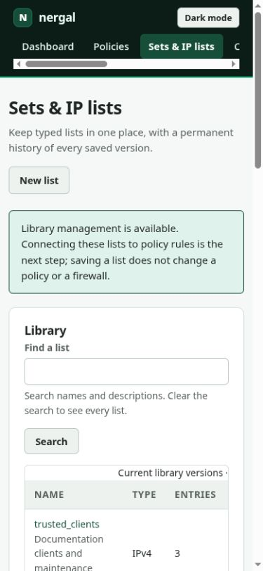

# Sets & IP lists

The **Sets & IP lists** screen provides a database-backed library of typed IPv4,
IPv6 and transport-port lists. Administrators can create, describe, search and edit
lists without JSON. Auditors can inspect current contents and version history.

## Create and maintain a list

Choose **New list**, enter a unique lowercase name, choose a type and add 1–64
entries, one per line. Field hints explain the format and limits. Addresses become
canonical CIDRs; CIDRs must have zero host bits. Ports are individual integers from
1 to 65535. Mixed families, hostnames, scoped/mapped addresses, ranges, duplicate
canonical entries, dynamic flags and timeouts are rejected explicitly.

Each save appends an immutable version and audit event atomically. Object names,
types and identities remain fixed. Historical views are read-only; they do not
restore or apply a list. Stale edits return a conflict and retain your input so
you can compare with the current version. There is no forced overwrite or deletion.
Times remain UTC in storage and appear in your browser's timezone with its name
in the footer.

## Current support boundary

Library management is implemented. **Policy references and native named-set
compilation are not yet implemented.** Saving a list does not create a policy
revision or alter a firewall. The application does not invent usage counts.
Future policy integration must pin immutable object versions/content into saved
revisions, expose impact and require review plus confirmed apply. Editing a shared
list must never silently change a saved policy.

The library retains at most 128 lists and 64 versions per list. Descriptions are
plain text up to 500 characters. Database protection definitions and content digests
are validated; a failed save leaves no partial list or audit event.

New controller stores use schema 3. Existing schema-1/2 stores require the explicit
offline `nergal-admin controller upgrade ABSOLUTE_CONTROLLER_DIRECTORY` after
stopping the writer and taking a verified SQLite backup. Sources, policies, hosts,
settings and audit history are preserved. The web process never migrates a database.
Additional SQL backends remain deferred.

## Appearance

These captures use a separate synthetic-only controller database. They demonstrate
library management, hints and local times; they do not establish native named-set
packet or rollback behavior.

