# Router migration and local testing

This page describes unreleased local development. It does not claim that a native
server configuration has been converted losslessly or deployed.

## Support and verification

| Construct | Development status |
| --- | --- |
| Raw prerouting rpfilter, FIB lookup, UDP source ports | Typed JSON, compiler, observation; real IPv4 spoof/bypass checks |
| TCP SYN MSS clamp | Typed JSON, compiler, observation; captured forwarded IPv4 SYN MSS 1360 |
| MAC matching/negation and ICMPx reject | Typed JSON, compiler, observation; real MAC+IP mismatch denial |
| Destination-keyed rate meters | Native reconstruction and dual-stack packet state-isolation checks |
| Negated interface/IP matchers | Explicit validated booleans, retained through compilation/observation |
| Postrouting masquerade/return and extended matchers | Real dual-stack translation and exemption source-address checks |
| Priority -5 auxiliary inet and bridge jump/return | Complete native receipts, real dual-stack packets, confirmed apply and rollback |

New router fields currently use **Advanced JSON & Revisions**. Simple structured
forms retain advanced settings and matchers; they do not yet offer controls for
every new field. The complete native candidate is available for inspection.

Extended bridge and independent `inet nergal_aux` tables support receipt-bound
confirmed apply. Packet checks cover dual-stack MAC+IP pinning and negation,
priority -5 ordering, bridge master matching and jump/return. Agent checks cover
confirmation, explicit/timeout rollback, controller loss and watchdog restart.
No unsupported matcher is silently dropped to create a weaker policy.

## Settings and appearance

The management UI follows the Lantea.One green masthead, emerald accents, charcoal
dark surfaces, and light paper palette. The theme toggle persists per browser;
management branding can select a default. Settings writes require Administrator
access, CSRF, validation, and an append-only audit entry.

Authentication, database, and firewall fields are **saved configuration intent**.
Saving them does not hot-reconfigure services. LDAP, PostgreSQL, and MariaDB
adapters are not implemented. Runtime sessions and SQLite use protected host
configuration. The newest saved revision is not necessarily a host's active policy.

The following screenshots were captured from the isolated local test controller
on November 22, 2026, with synthetic/default data. They contain no production
exports, topology, or credentials.

### Dark theme

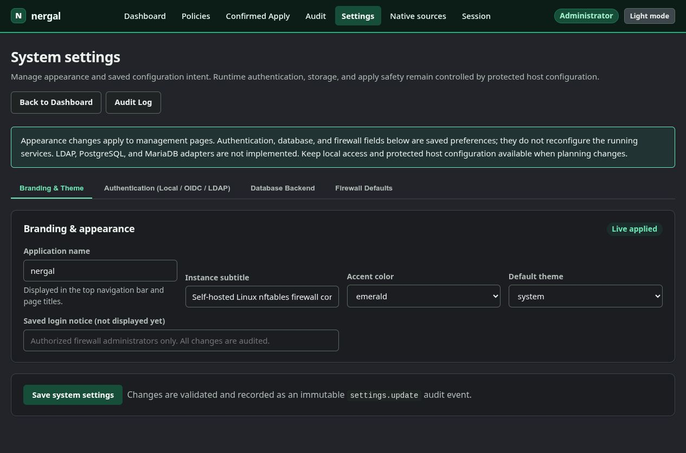

### Light theme

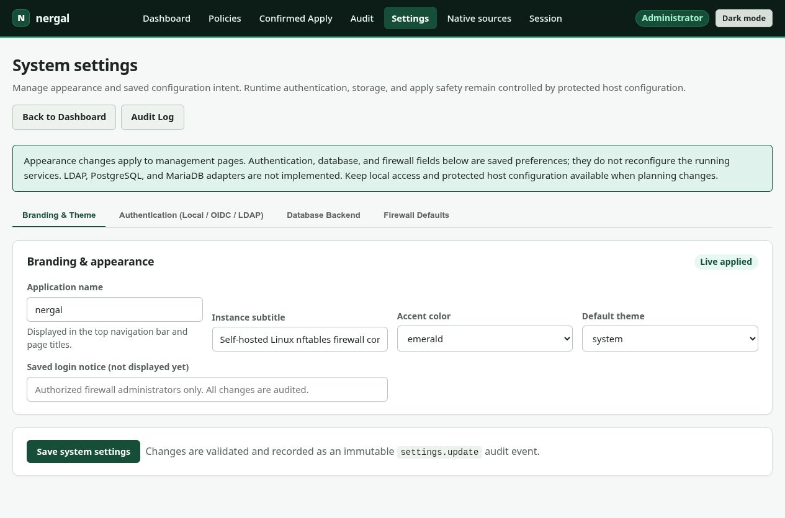

### Policy builder

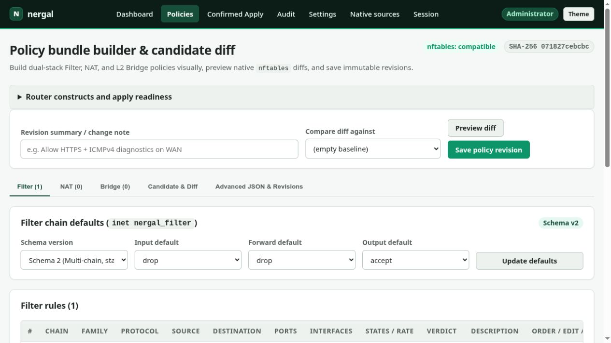

### Mobile layout

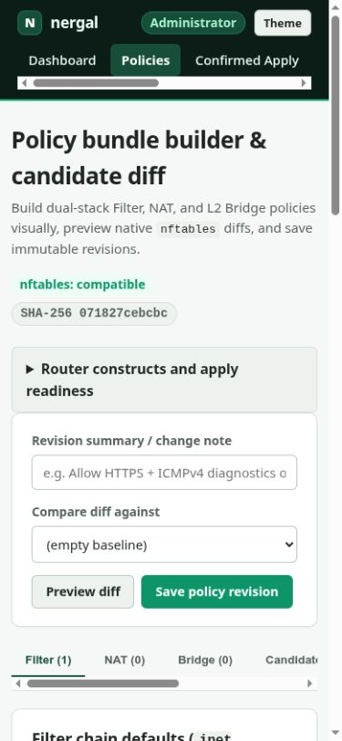

## Private local stack

`tools/dev-stack/up.sh` builds the pinned .NET Release app and runs a loopback-only
HTTPS controller at `https://127.0.0.1:5443/manage`. Optional repeated `--source`
arguments copy private native inputs into ignored local storage. The generated
account credentials are in `artifacts/dev-stack/private/access.txt`, never in the
public documentation. The operator handles the local certificate warning.

The web container has no firewall capabilities or production agent connection.
Each source has a separate container with no network access, a read-only source,
and native check-only validation. A successful check establishes syntax in that
container, not imported-policy equivalence or server packet correctness.
Administrators can inspect exact escaped snapshots at **Native sources**; Auditors
are denied. Sources are not applied. Each snapshot now has a source-bound migration
review with line references and an administrator-only JSON download. The review
highlights typed mapping work, definitions/includes, and gap signals such as maps,
`notrack` and counters. It is a non-exhaustive lexical inventory: keyword occurrences
can be identifiers, and unknown syntax is not validated. Every report keeps
conversion blocked; no managed candidate is created. Empty or familiar input never
becomes implicitly compatible. The five private sources still need explicit rule
mapping and packet-level equivalence work.

`tools/dev-stack/watch.py` supervises application/source refreshes while the local
process runs. It preserves private accounts, keys, and saved UI data and reports
its outcome in `artifacts/dev-stack/watch-status.txt`. It is not a boot service.

## Checks and limits

Release builds, unit coverage, the web smoke test, the native nftables fixture,
router packet fixture, HTTPS session/settings fixtures, and the existing watchdog
fixture provide separate evidence. The mapped-UID local-status suite passes through the disposable container runner
when host `newuidmap` capabilities are unavailable.
Passing unit tests and source syntax checks do not prove production deployment or
complete new-feature rollback. No production firewall is touched by this workflow.

## Complete observation milestone

The development branch now reconstructs complete owned NAT, extended bridge and
early inet snapshots. A disposable namespace check compares native echo and
independent listings across all four owned tables. Unit and protected-journal
checks detect auxiliary-only drift even when the primary filter is unchanged.
Dedicated packet, watchdog and restart conformance now enables the supported
extended bridge and early inet slice. Unexpected native drift or ambiguous
unacknowledged replacement enters `RecoveryRequired` without overwriting state. See the [testing guide](testing-and-conformance.md)
and [receipt design](https://git.lantea.one/lantea-one/nergal/src/branch/main/docs/decisions/0036-complete-bundle-observation-and-rollback.md).

## JSON code editor

Advanced policy authoring uses a locally bundled CodeMirror editor with line
numbers, folding, syntax highlighting, search, bracket matching, indentation and
JSON syntax diagnostics. Both console themes are supported. Preview still performs
strict server policy validation, and invalid input stays visible for correction.
The editor does not permit raw native firewall transactions.

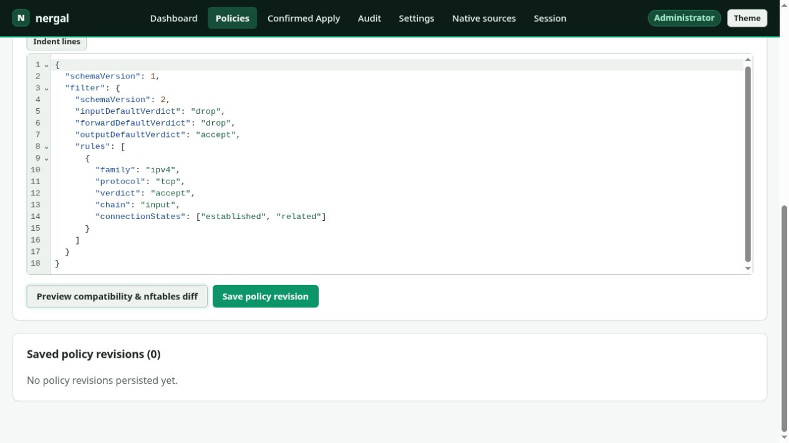

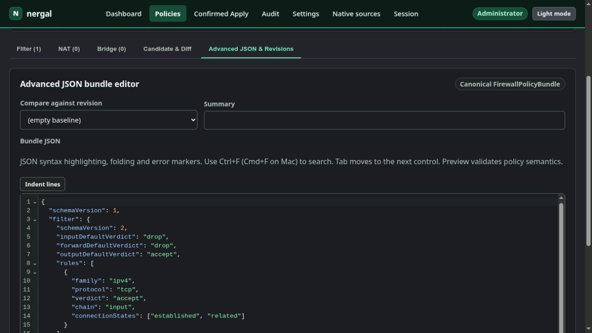

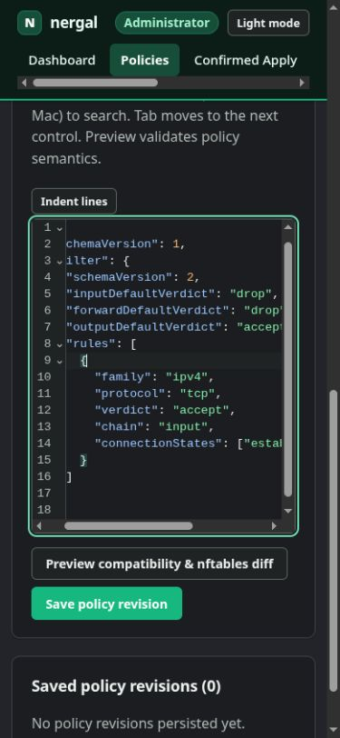

## Matching documentation appearance

The documentation portal shares the application's actual stylesheet and theme
initialization. Its masthead, typography, colors, controls, article surfaces and
light/dark appearance follow the same design. Search, tables, code blocks and
Mermaid diagrams also adapt to the selected theme. Mobile navigation keeps article
content within the viewport. Theme choices persist separately for each origin.

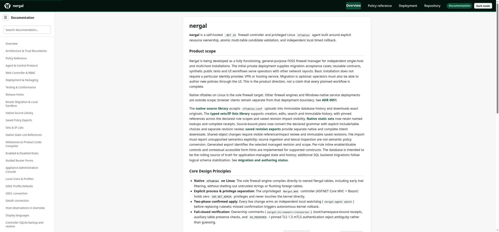

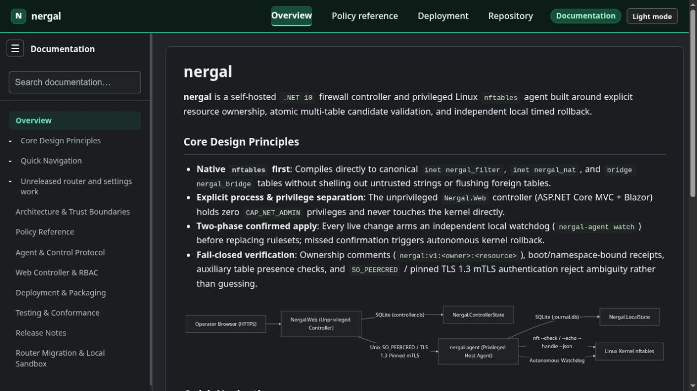

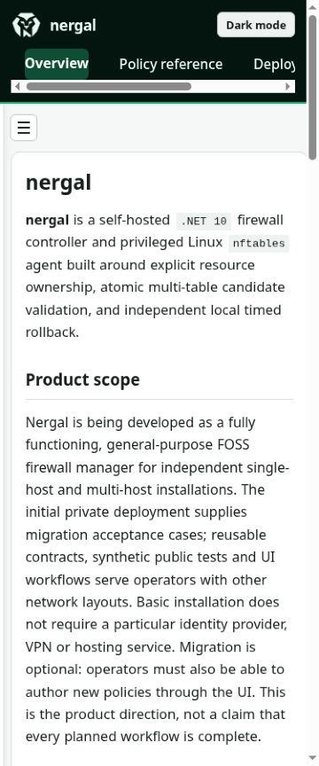

## Auxiliary apply acceptance

Complete auxiliary apply now requires native receipt evidence across every owned
table. An unchanged primary table cannot conceal auxiliary drift. Recreated tables
with copied markers, missing tables, unknown expressions and foreign collisions
are denied without repair or adoption. The watchdog can resume a recorded operation
after restart; a kernel replacement with no durable receipt remains a manual
recovery case. Source-bound private migration reviews are available; explicit
server conversion and complete structured authoring remain the next milestones.

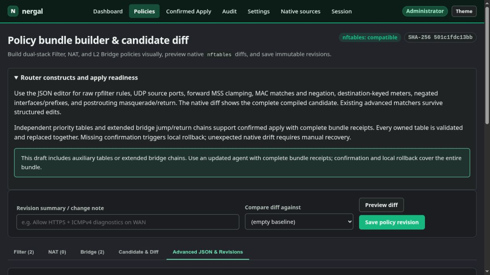

## Migration review appearance

The administrator-only Native sources screen presents review topics and source
line references using the application theme. The screenshots below use a synthetic
configuration only. Private server sources and reports are never published here.
The review table scrolls within its container on narrow screens.

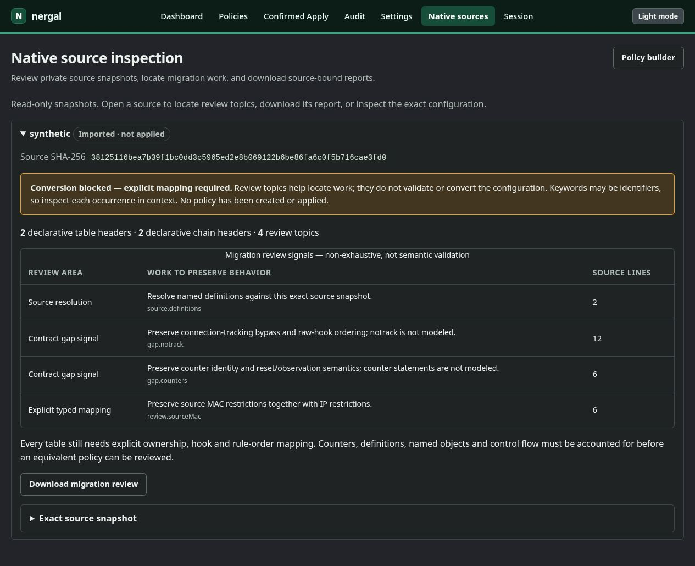

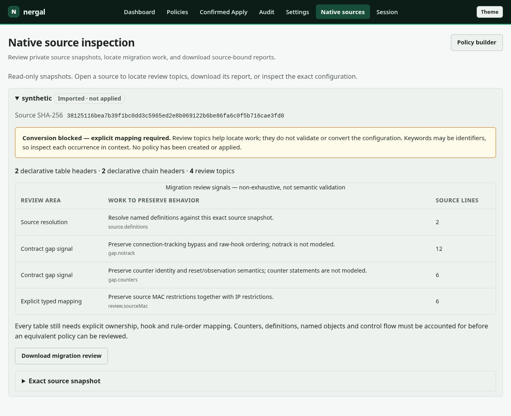

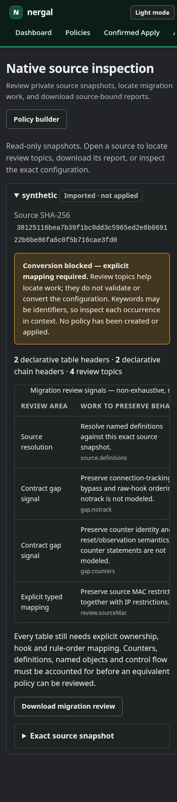
