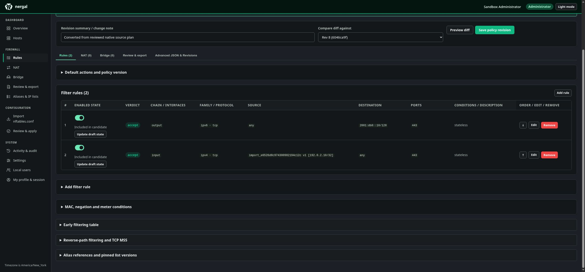

# Enabled and disabled rules

Every supported rule has a versioned enabled state. Existing documents default to
enabled. **Policies** provides an inline **Enabled** switch and **Update draft
state** button for primary filter, DNAT, postrouting and bridge forward rules.
The raw/auxiliary/sub-chain section exposes the same controls for rpfilter,
early-inet rules, bridge regular chains and the configured MSS clamp.

1. Change a switch and choose **Update draft state**. This changes only the
   submitted draft; it does not save a revision or contact an agent.
2. Review the retained rule settings and **Candidate & Diff**. The intent diff
   includes enabled flags, dormant settings and pinned references; the native diff
   shows actual candidate enforcement changes.
3. Save an immutable policy revision, then use the existing confirmed-apply
   workflow for an explicitly selected host. Missed confirmation still triggers
   the agent's independent local timed rollback.

Disabled rules retain their position, description, matchers, action and pinned
object versions. Re-enable to restore the rule with those settings. Ordinary rule
editing/reordering retains state. The MSS clamp retains its size separately from
its enabled flag. Removing a rule is a different operation.

Disabling an accept rule may block traffic. Disabling a drop or return exemption
may broaden traffic or expose a later NAT translation; disabling an MSS clamp can
change connectivity. Chain defaults and subsequent rules remain in effect. Changes reach a host only after revision review and confirmed apply.

## Validation and native observation

All rules, including disabled rules, undergo full semantic validation and database
reference verification. Unknown fields, invalid families/ports, unsupported jump
targets, incompatible references and bad MSS sizes cannot be hidden in dormant
intent. The JSON `enabled` property must be a boolean; only false needs to be
written. `forwardTcpMssClampEnabled` behaves the same way for a retained clamp.
Older agents reject unknown fields; use updated controller and agent builds.

After validation, compilation emits only enabled rules, their dynamic meter
objects and an enabled MSS clamp. Active-rule relative order is unchanged. Explicit
chain/table declarations and defaults remain, even if all their rules are disabled.
Native echo/list observations describe active enforcement only. They cannot recover
dormant rules, metadata or original controller list references. Controller revision
JSON is authoritative for that intent; protected native artifacts and complete
receipts remain authoritative for agent ownership/recovery. No generated export or
semantic native import capability is implied.

Administrators may change draft state with CSRF protection. Auditors can inspect
state but have no mutation control; anonymous and Auditor writes are denied. State
changes and retained settings live in ordinary immutable policy revision JSON, so
controller schema remains 3 and timestamps retain UTC storage/local display.

See [the remaining milestones](milestones.md) and [testing evidence](testing-and-conformance.md).

Enablement uses the same labelled on/off switch as local-user access and system
settings. Tab focuses a switch; Space changes its proposed state. The knob position, green enabled/red disabled colors and
assistive-technology switch state reflect the current form value. Switches have
descriptive screen-reader names without visible state text. Switches work without JavaScript. Use the separate save/update action to
submit; firewall rules still require revision review and confirmed apply.
